<div align="center">


<br/>

<a href="https://github.com/Yoge-2004/expense-tracker">
  
</a>

<br/>

<p align="center">
  <a href="https://github.com/Yoge-2004/expense-tracker/actions/workflows/ci.yml">
    
  </a>
  <a href="https://github.com/Yoge-2004/expense-tracker/actions/workflows/android-apk.yml">
    
  </a>
  <a href="https://huggingface.co/spaces/Yoge-2004/expense-tracker-backend">
    
  </a>
  <a href="https://github.com/Yoge-2004/expense-tracker/releases/latest">
    
  </a>
  <a href="LICENSE">
    
  </a>
</p>

<p align="center">
  
  
  
  
  
  
  
  
  
  
</p>

<p align="center">
  <b>Autonomous Financial Command Center • Instant Cash Flow Reconciliation • High-Performance Cross-Platform Engine</b>
</p>

<p align="center">
  <a href="#-executive-overview"></a>
  <a href="#-enterprise-architecture--system-topology"></a>
  <a href="#-feature-portfolio"></a>
  <a href="#-mobile-companion-suite"></a>
  <a href="#-rest-api-specification"></a>
  <a href="#-quick-start-guide"></a>
  <a href="#-testing-ecosystem-557-tests"></a>
</p>


</div>

## 📑 Interactive Table of Contents

<details open>
<summary><b>🧭 Click to Toggle Full Navigation Index</b></summary>

<br/>

- [🌟 Executive Overview](#-executive-overview)
- [⚖️ Enterprise Comparison Matrix](#️-enterprise-comparison-matrix)
- [🏗️ Enterprise Architecture & System Topology](#️-enterprise-architecture--system-topology)
  - [1. High-Level Distributed Infrastructure (C4 Model)](#1-high-level-distributed-infrastructure-c4-model)
  - [2. Spring Boot Backend Layered Pipeline](#2-spring-boot-backend-layered-pipeline)
  - [3. Relational Database Entity-Relationship Model (ERD)](#3-relational-database-entity-relationship-model-erd)
  - [4. Transaction Lifecycle & State Machine](#4-transaction-lifecycle--state-machine)
  - [5. Continuous ML Fleet Retraining & Feedback Loop](#5-continuous-ml-fleet-retraining--feedback-loop)
  - [6. Client-Side Dual-Mode OCR & Multi-Tax Decomposition Pipeline](#6-client-side-dual-mode-ocr--multi-tax-decomposition-pipeline)
- [💎 Feature Portfolio](#-feature-portfolio)
  - [1. Unified Cash Flow Ledger & Dual-Stream Audit Trail](#1-unified-cash-flow-ledger--dual-stream-audit-trail)
  - [2. Inflow Intelligence & Income Stream Governance](#2-inflow-intelligence--income-stream-governance)
  - [3. Multi-Tax Receipt OCR Scanner (Client-Side Privacy-First)](#3-multi-tax-receipt-ocr-scanner-client-side-privacy-first)
  - [4. Continuous Intelligence Machine Learning Fleet](#4-continuous-intelligence-machine-learning-fleet)
  - [5. Power BI-Grade Excel Analytics & Interactive Data Hub](#5-power-bi-grade-excel-analytics--interactive-data-hub)
  - [6. Budget Allocation & Velocity Variance Engine](#6-budget-allocation--velocity-variance-engine)
  - [7. Active Subscriptions & Recurring Financial Commitment Engine](#7-active-subscriptions--recurring-financial-commitment-engine)
  - [8. Savings Goals Milestones & Contribution Vault](#8-savings-goals-milestones--contribution-vault)
  - [9. Web Studio & Universal Appearance Engine (12 Luxury Themes)](#9-web-studio--universal-appearance-engine-12-luxury-themes)
  - [10. Executive Command Palette & Fluid Ambient HUD Pointer](#10-executive-command-palette-ctrlcmd--k--fluid-ambient-hud-pointer)
  - [11. Draggable Quick Calculator & Multi-Currency FX Converter](#11-draggable-quick-calculator--multi-currency-fx-converter)
  - [12. Stealth Privacy Mode & Visual Obfuscation](#12-stealth-privacy-mode--visual-obfuscation)
  - [13. Safe-to-Spend Daily Allowance & Habit Streaks](#13-safe-to-spend-daily-allowance--habit-streaks)
  - [14. Zero-Trust Security, WebAuthn Passkeys & Step-Up Admin PIN](#14-zero-trust-security-webauthn-passkeys--step-up-admin-pin)
  - [15. Responsive Cross-Platform Command Studio](#15-responsive-cross-platform-command-studio)
- [📱 Mobile Companion Suite](#-mobile-companion-suite)
  - [1. Mobile Feature Architecture & Capabilities](#1-mobile-feature-architecture--capabilities)
  - [2. Mobile Touch Gestures & Haptics Matrix](#2-mobile-touch-gestures--haptics-matrix)
  - [3. SMS Banking Debit Parser Engine](#3-sms-banking-debit-parser-engine)
- [🎮 Keyboard & Desktop Accelerators Guide](#-keyboard--desktop-accelerators-guide)
- [🔌 REST API Specification](#-rest-api-specification)
- [🧠 Machine Learning Fleet & Benchmark Matrix](#-machine-learning-fleet--benchmark-matrix)
- [⚡ Performance Engineering & Java 27 Optimization](#-performance-engineering--java-27-optimization)
- [🛠️ Technology Stack Architecture](#️-technology-stack-architecture)
- [📂 Repository Layout Map](#-repository-layout-map)
- [🚢 Deployment & DevOps Ecosystem](#-deployment--devops-ecosystem)
- [🚀 Quick Start Guide](#-quick-start-guide)
- [⚙️ Environment Variables Reference](#️-environment-variables-reference)
- [🧪 Testing Ecosystem (557+ Tests)](#-testing-ecosystem-557-tests)
- [📦 Releases & Installation](#-releases--installation)

</details>


## 🌟 Executive Overview

**ExpenseTracker PRO** is an enterprise-grade financial command center designed around one immutable engineering principle: **personal and corporate financial intelligence, recording, and reconciliation should be instantaneous, zero-latency, private, and architecturally resilient.**

Modern wealth management and expense auditing are frequently broken across fragmented SaaS tools: clunky spreadsheets, privacy-invasive third-party aggregators that monetize consumer banking data, slow electron-based wrappers, and disconnected mobile apps. 

Operating on **Java 27** using Generational ZGC, **Spring Boot 4.1.1**, **Python 3.14**, and **Expo React Native**, ExpenseTracker PRO harmonizes four cooperating surfaces:
1. **🌐 Web Command Studio** — High-velocity browser desktop center with 12 luxury atmospheric themes, diffused ambient lighting, and sub-millisecond filtering.
2. **📱 Mobile Native Companion** — Expo React Native client supporting offline caching, native haptic feedback, SMS bank debit parsing, and biometric authentication.
3. **⚙️ Enterprise Core API** — Spring Boot microservices managing JWT/OAuth2/WebAuthn identity, business rule validation, audit trails, and Apache POI Excel analytics.
4. **🧠 AI Machine Learning Microservice** — Dedicated Python 3.14 FastAPI engine powering dual-model categorization, merchant index vectorization, transaction anomaly scoring, and automated retraining pipelines.

<picture>
  <source media="(prefers-color-scheme: dark)" srcset="docs/images/website/hero-dashboard.png">
  <source media="(prefers-color-scheme: light)" srcset="docs/images/website/hero-dashboard.png">
  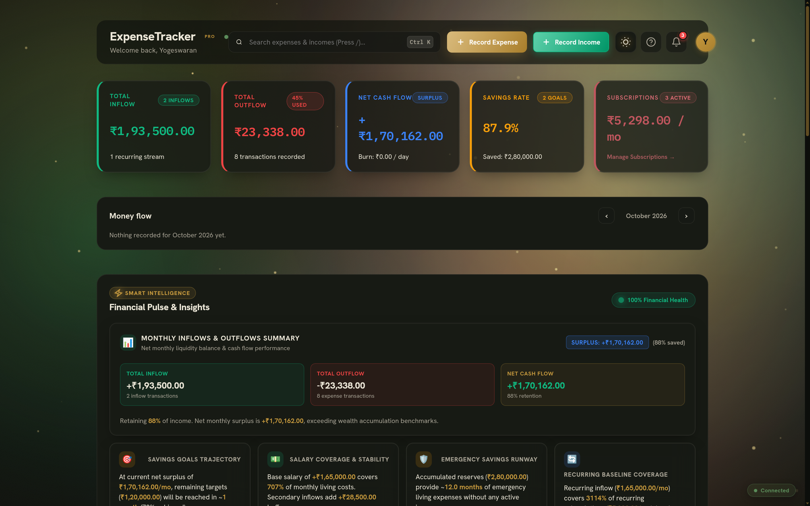
</picture>

<br/><br/>

<picture>
  <source media="(prefers-color-scheme: dark)" srcset="docs/images/website/platform-overview.png">
  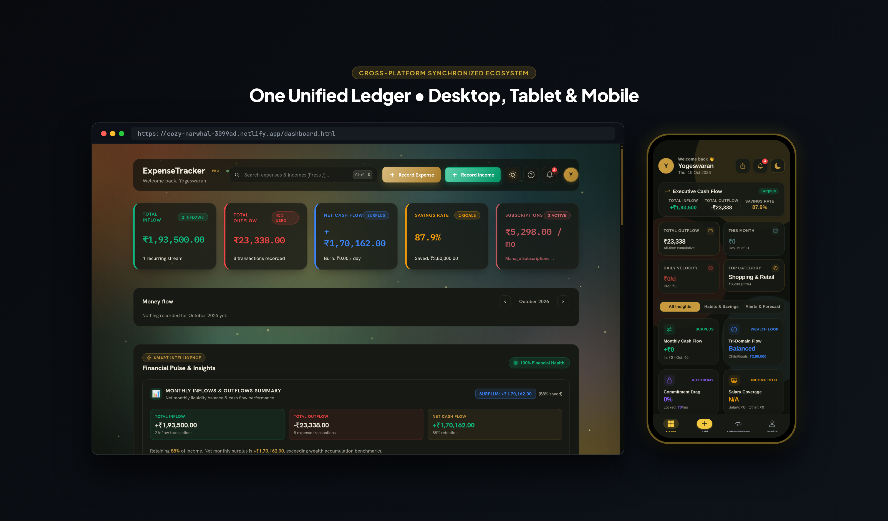
</picture>


## ⚖️ Enterprise Comparison Matrix

<details open>
<summary><b>📊 ExpenseTracker PRO vs. Legacy SaaS & Spreadsheets</b></summary>

<br/>

| Dimension | 🏆 ExpenseTracker PRO | 📊 Excel / Spreadsheets | 🏦 Mint / Credit Karma | 🎯 YNAB (You Need A Budget) | 👥 Splitwise |
|---|:---:|:---:|:---:|:---:|:---:|
| **Privacy & Data Sovereignty** | `100% Self-Hosted & Local` | Local file | 3rd-Party Cloud / Data Sold | 3rd-Party Cloud | 3rd-Party Cloud |
| **Pricing & Licensing** | `Free & Open Source (Apache 2.0)` | Paid Office 365 | Ad-supported / Monetized | \$100+/year subscription | Freemium / Paid Pro |
| **Client-Side Receipt OCR** | `✅ WebAssembly (Zero Leakage)` | ❌ None | ❌ Cloud OCR | ❌ Manual Entry Only | ⚠️ Cloud OCR (Pro only) |
| **Dual AI Categorization** | `✅ TF-IDF + DistilBERT` | ❌ Manual Rules | ⚠️ Primitive Heuristics | ❌ Manual Assignment | ❌ None |
| **Continuous Model Retraining** | `✅ Self-Retraining ML Fleet` | ❌ None | ❌ Static Black Box | ❌ None | ❌ None |
| **Mobile Banking SMS Parsing** | `✅ Real-time Android/iOS` | ❌ None | ⚠️ Bank Aggregator APIs | ❌ None | ❌ None |
| **Power BI-Grade Excel Output** | `✅ Apache POI Auto-Generated` | ⚠️ Manual Formulas | ❌ Flat CSV Only | ❌ Flat CSV Only | ❌ Flat CSV Only |
| **Biometric Passkeys (WebAuthn)** | `✅ FIDO2 Hardware Keys` | ❌ None | ❌ Password / 2FA | ❌ Password / 2FA | ❌ Password Only |
| **Disaster Recovery Hybrid Sync** | `✅ Postgres + SQLite + HF` | ❌ Manual Backup | ❌ Vendor Lock-in | ❌ Vendor Lock-in | ❌ None |
| **High-Throughput Runtime** | `✅ Java 27 Virtual Threads` | ❌ Desktop App | ❌ Closed SaaS | ❌ Closed SaaS | ❌ Closed SaaS |

</details>


## 🏗️ Enterprise Architecture & System Topology

### 1. High-Level Distributed Infrastructure (C4 Model)

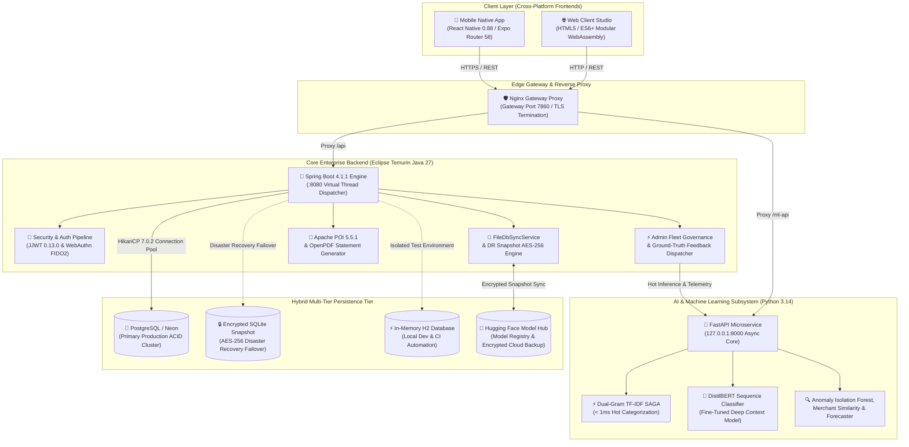

<picture>
  <source media="(prefers-color-scheme: dark)" srcset="docs/images/architecture/system-architecture.png">
  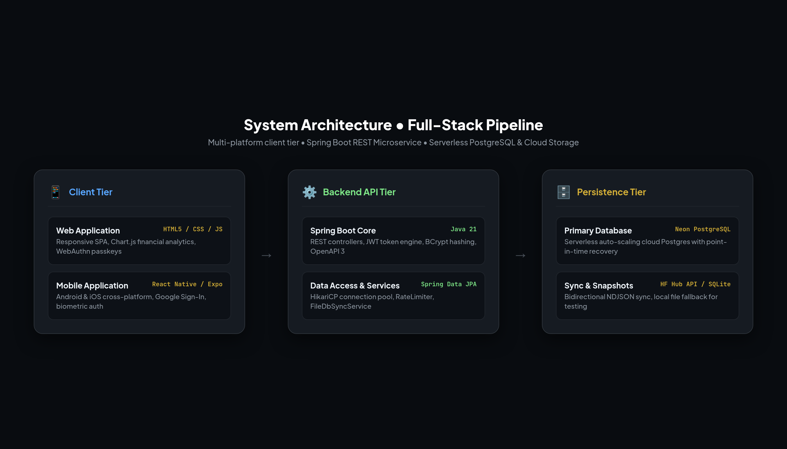
</picture>

---

### 2. Spring Boot Backend Layered Pipeline

```mermaid
flowchart TD
    subgraph Presentation ["1. Presentation Layer (REST Controllers)"]
        C_Auth["AuthController (/api/auth)"]
        C_Exp["ExpenseController (/api/expenses)"]
        C_Inc["IncomeController (/api/incomes)"]
        C_Bud["BudgetController (/api/budgets)"]
        C_Sav["SavingsController (/api/savings)"]
        C_Gov["AdminController (/api/admin)"]
        C_Rep["ReportController (/api/reports)"]
    end

    subgraph SecurityChain ["2. Security & Filter Pipeline"]
        Sec_Cfg["SecurityConfiguration"]
        Jwt_Filt["JwtAuthenticationFilter"]
        Cors_Filt["CorsConfigurationSource"]
        Rate_Lim["RateLimitingFilter"]
        WebAuthn_Filt["WebAuthnPasskeyFilter"]
    end

    subgraph ServiceLayer ["3. Business Domain Services"]
        S_Exp["ExpenseService & Category Logic"]
        S_Inc["IncomeService & Inflow Rules"]
        S_Bud["BudgetService & Velocity Math"]
        S_Sav["SavingsService & Milestone Vault"]
        S_Gov["AdminMlGovernanceService"]
        S_Rep["ReportService (POI / PDF)"]
        S_Sync["FileDbSyncService (DR Snapshots)"]
    end

    subgraph Repositories ["4. Data Access Layer (Spring Data JPA)"]
        R_Exp["ExpenseRepository"]
        R_Inc["IncomeRepository"]
        R_Bud["BudgetRepository"]
        R_Sav["SavingsRepository"]
        R_User["UserRepository"]
        R_Audit["CategoryAuditRepository"]
    end

    subgraph Entities ["5. Relational Database Tables"]
        E_Exp[("expenses")]
        E_Inc[("incomes")]
        E_Bud[("budgets")]
        E_Sav[("savings_goals")]
        E_User[("users")]
        E_Audit[("category_feedback_audit")]
    end

    SecurityChain --> Presentation
    Presentation --> ServiceLayer
    ServiceLayer --> Repositories
    Repositories --> Entities
```

---

### 3. Relational Database Entity-Relationship Model (ERD)

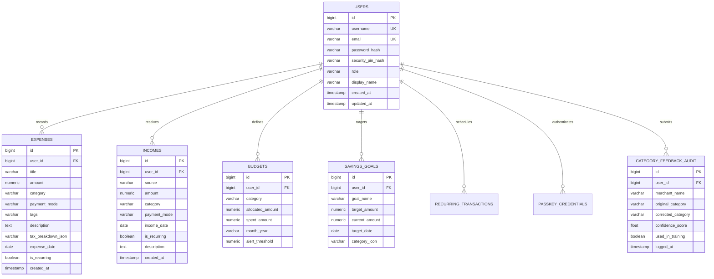

---

### 4. Transaction Lifecycle & State Machine

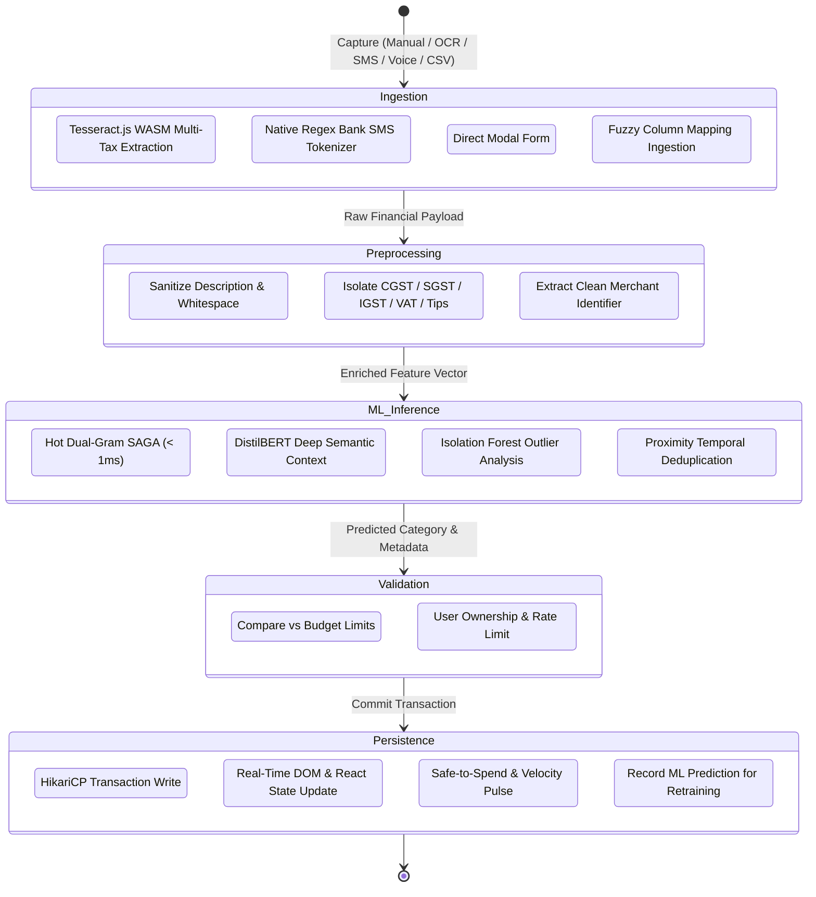

---

### 5. Continuous ML Fleet Retraining & Feedback Loop

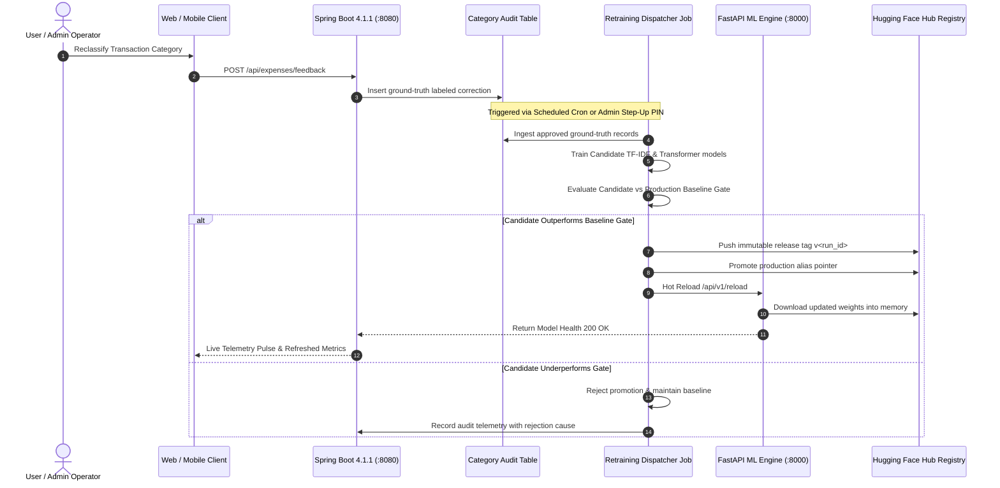

---

### 6. Client-Side Dual-Mode OCR & Multi-Tax Decomposition Pipeline

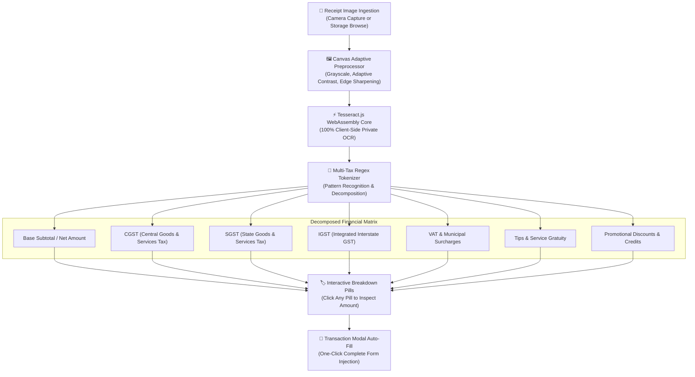

<picture>
  <source media="(prefers-color-scheme: dark)" srcset="docs/images/architecture/data-sync.png">
  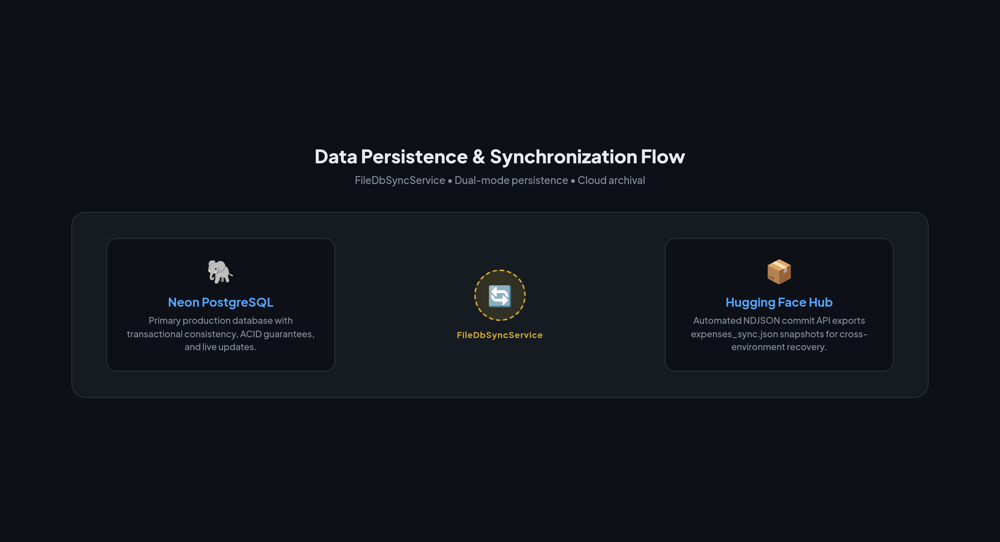
</picture>


## 💎 Feature Portfolio

### 1. Unified Cash Flow Ledger & Dual-Stream Audit Trail

The **Unified Ledger** combines expense outflows and income inflows into a single, high-density chronological timeline:
- **Instant Multi-Column Search**: Filter by merchant, note, tags, category, or payment mode with debounced sub-millisecond DOM updates.
- **Bi-Directional Sorting**: Sort instantly by date, magnitude, category, or cadence (one-time vs recurring).
- **Inline Action System**: Rapid-edit and safety-confirmed delete workflows without losing scroll position.
- **Color-Coded Status Tags**: Immediate visual distinction between outgoing expenses (crimson/amber) and incoming inflows (emerald/sapphire).

<picture>
  <source media="(prefers-color-scheme: dark)" srcset="docs/images/website/expenses.png">
  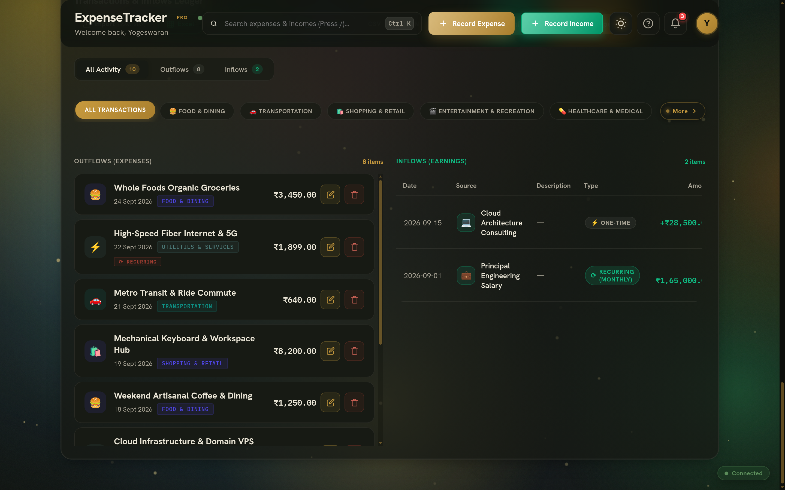
</picture>

---

### 2. Inflow Intelligence & Income Stream Governance

ExpenseTracker PRO treats incoming revenue with the same first-class architectural rigor as expense tracking:
- **Categorized Inflow Streams**: Track Salary, Freelance, Dividends, Crypto, Staking, Rental Income, and Royalties.
- **Recurring Inflow Schedules**: Model recurring paychecks, client retainers, and automatic investment yields.
- **Gross vs Net Inflow Analytics**: Deduct estimated tax withholdings and corporate fees to project actual spendable reserves.
- **Cash Flow Velocity Ratio**: Dynamically calculates income-to-expense burn ratios:
  $$	ext{Burn Ratio} = rac{\sum 	ext{Expenses}}{\sum 	ext{Incomes}} 	imes 100\%$$

<picture>
  <source media="(prefers-color-scheme: dark)" srcset="docs/images/website/income.png">
  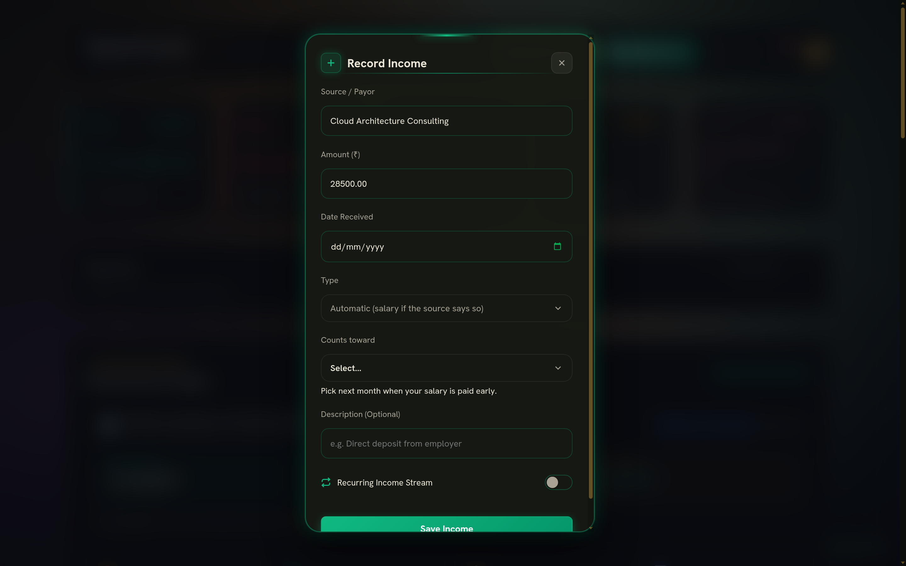
</picture>

<details>
<summary><b>🔍 View Inflow Stream Detail Breakdown</b></summary>
<br/>
<picture>
  <source media="(prefers-color-scheme: dark)" srcset="docs/images/website/income-detail.png">
  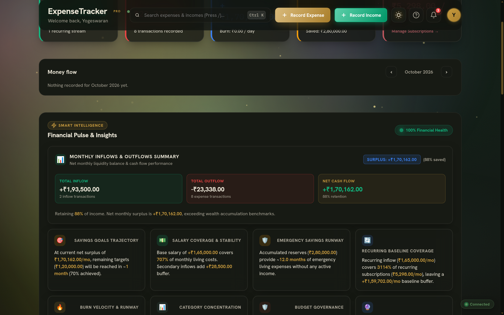
</picture>
</details>

---

### 3. Multi-Tax Receipt OCR Scanner (Client-Side Privacy-First)

Powered by client-side WebAssembly, the scanner processes invoices locally on the user's device without transmitting receipt photos to external servers:
- **Dual Ingestion**: Real-time live camera capture or drag-and-drop file browse from gallery/desktop.
- **Adaptive Image Processing**: Canvas filters apply binarization, adaptive contrast, and edge sharpening to decipher faded thermal paper receipts.
- **Comprehensive Tax Parsing**: Automatically tokenizes and isolates Base Net, CGST, SGST, IGST, VAT, Gratuity, and Promotional Discounts.
- **Interactive Breakdown Matrix**: Renders visual tax pills below the scan viewport. Clicking any pill auto-fills the expense form in 1 click.

<picture>
  <source media="(prefers-color-scheme: dark)" srcset="docs/images/website/add-expense.png">
  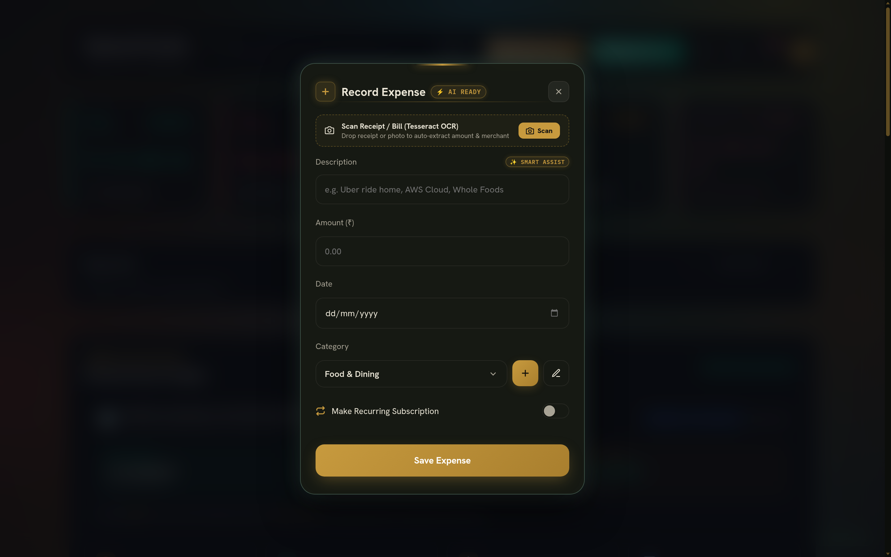
</picture>

---

### 4. Continuous Intelligence Machine Learning Fleet

The ML subsystem operates as an asynchronous, thread-safe microservice running alongside Spring Boot:
- **Dual-Engine Architecture**:
  - `TF-IDF + Logistic Regression (SAGA)`: Sub-millisecond inference for instant categorization of standard transactions.
  - `DistilBERT Sequence Classifier`: Fine-tuned contextual transformer for ambiguous or composite descriptions.
- **Auxiliary Intelligence Models**: Merchant similarity index, duplicate transaction detector, Isolation Forest anomaly scoring, and 7-to-30 day cash flow forecaster.
- **Automated Continuous Learning Loop**: User reclassifications are logged to an audit table; scheduled retraining triggers candidate benchmark evaluations against the production baseline.

<picture>
  <source media="(prefers-color-scheme: dark)" srcset="docs/images/website/dashboard.png">
  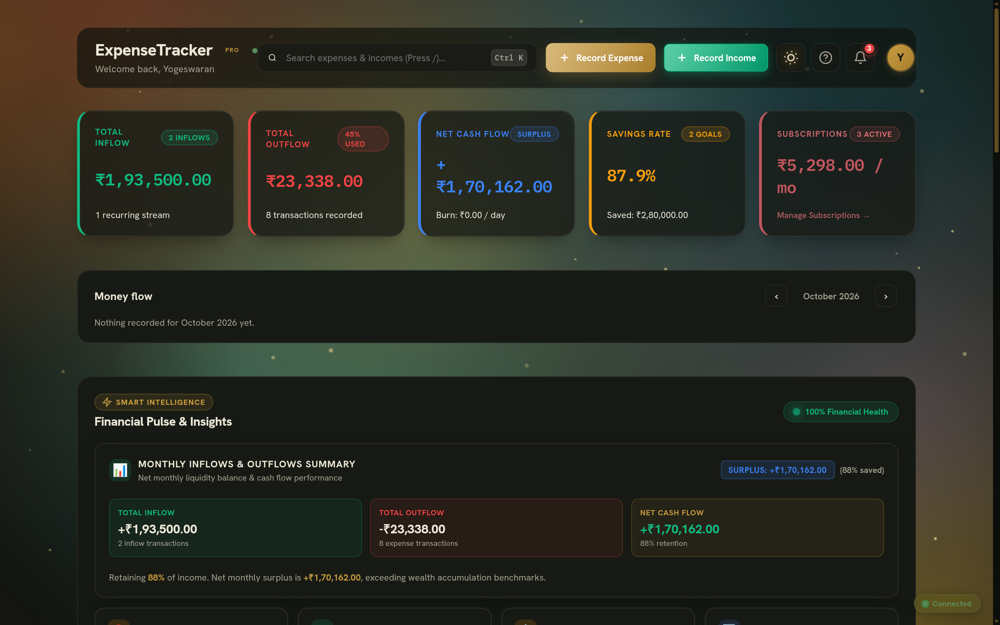
</picture>

---

### 5. Power BI-Grade Excel Analytics & Interactive Data Hub

- **Executive Excel Workbooks**: Generates formatted `.xlsx` workbooks styled to modern Power BI dashboards using Apache POI:
  - **Sheet 1 — Executive Summary**: KPI Metric Cards, Net Cash Reserves, Inflow/Outflow Delta, Savings Velocity, Monthly Cash Runway.
  - **Sheet 2 — Expense Outflow Ledger**: Formatted currency columns, category color tags, payment mode metadata, notes.
  - **Sheet 3 — Inflow Income Ledger**: Gross income, net received, frequency distribution.
  - **Sheet 4 — Category Breakdown & Pivot**: Automatic Excel `SUMIF` formulas and dynamic percentage charts.
  - **Sheet 5 — Budget Variance Analysis**: Actual spend vs allocated budget with variance indicators.
- **Corporate PDF Statements**: Generates print-ready vector PDF statements with executive watermarks, summary tables, and signature audit lines via OpenPDF.
- **Data Hub Portability**: 1-click JSON snapshot exports, CSV batch exports, and encrypted SQLite disaster recovery downloads.

<picture>
  <source media="(prefers-color-scheme: dark)" srcset="docs/images/website/reports.png">
  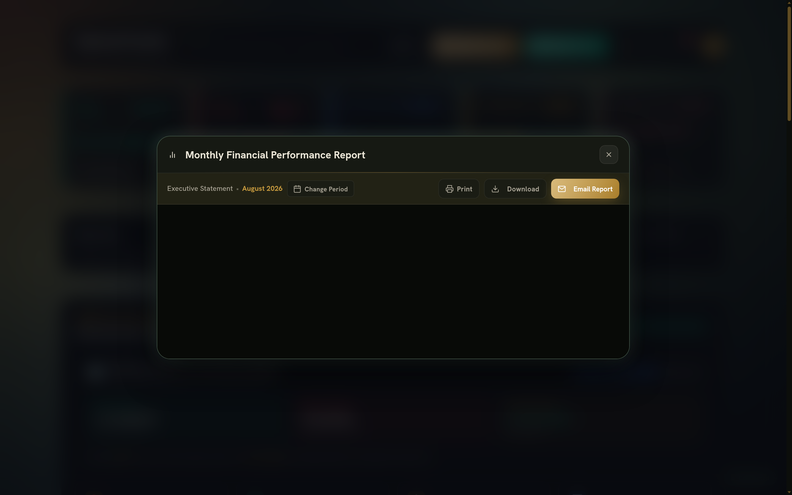
</picture>

<details>
<summary><b>🔍 View Data Hub & Report Export Center</b></summary>
<br/>
<picture>
  <source media="(prefers-color-scheme: dark)" srcset="docs/images/website/report-exports.png">
  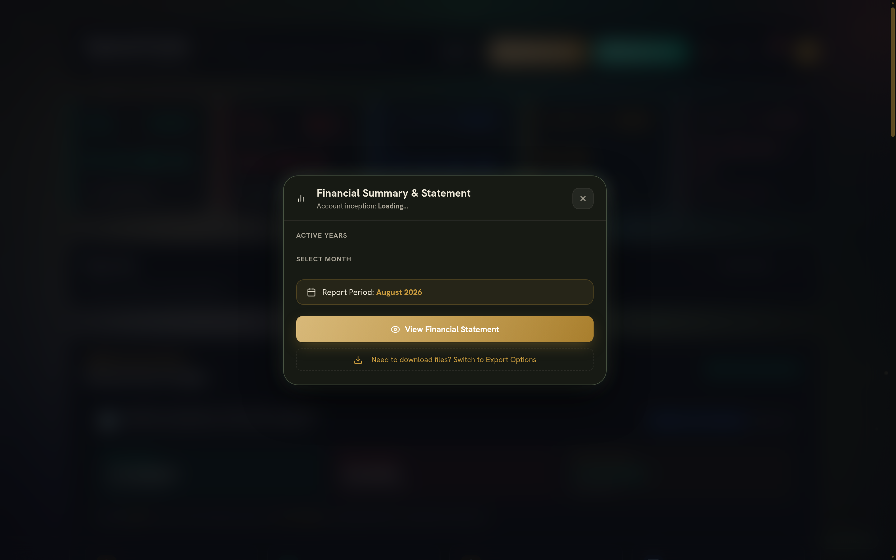
</picture>
</details>

---

### 6. Budget Allocation & Velocity Variance Engine

- **Category-Level Envelopes**: Allocate strict or flexible monthly spending allowances per category.
- **Dynamic Burn Rate Alerts**: Receive threshold notifications when spending crosses 80%, 90%, and 100% of budgeted allocations.
- **Velocity Variance Tracking**: Calculates historical pace against elapsed days in the billing cycle to alert you before overspending occurs.

<picture>
  <source media="(prefers-color-scheme: dark)" srcset="docs/images/website/budgets.png">
  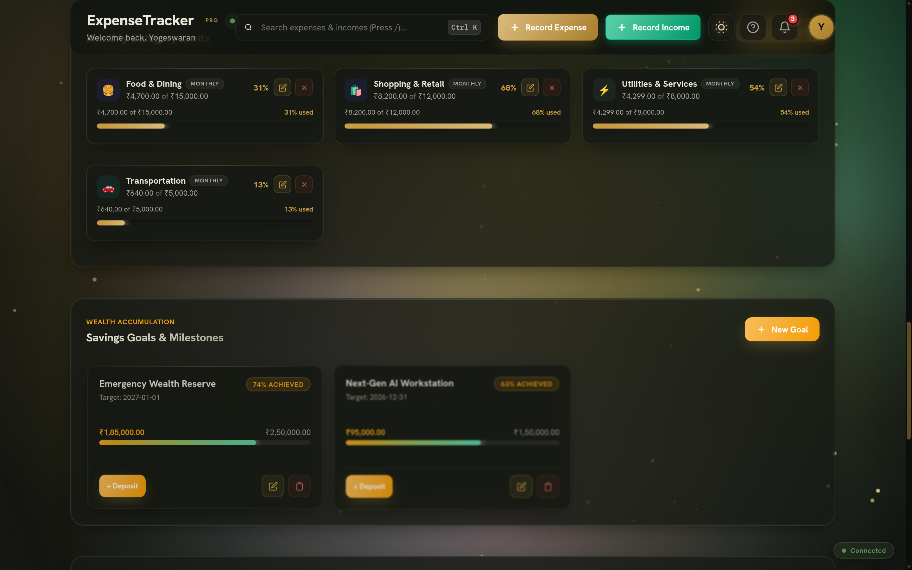
</picture>

<details>
<summary><b>🔍 View Budget Progress & Burn Rate Velocity</b></summary>
<br/>
<picture>
  <source media="(prefers-color-scheme: dark)" srcset="docs/images/website/budget-progress.png">
  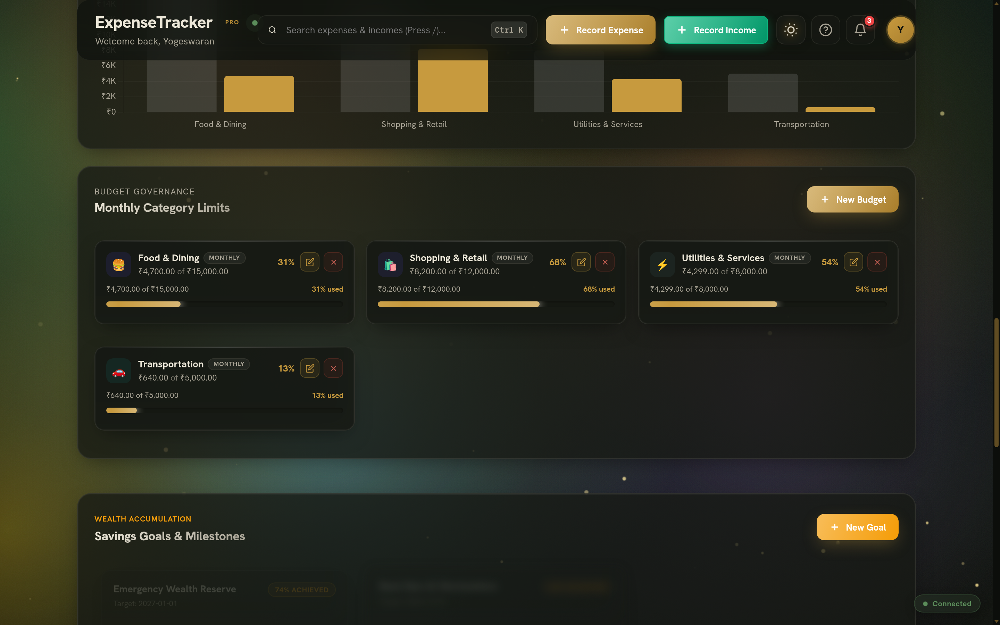
</picture>
</details>

---

### 7. Active Subscriptions & Recurring Financial Commitment Engine

- **Recurring Commitment Dashboard**: Track monthly, quarterly, and annual subscriptions with renewal countdown indicators.
- **Overdraft Protection**: Automatically projects upcoming commitment deductions to protect against overdrafts.
- **Cancellation Impact Forecaster**: Calculates exactly how much annual net worth increases if an underutilized recurring service is eliminated.

<picture>
  <source media="(prefers-color-scheme: dark)" srcset="docs/images/website/recurring.png">
  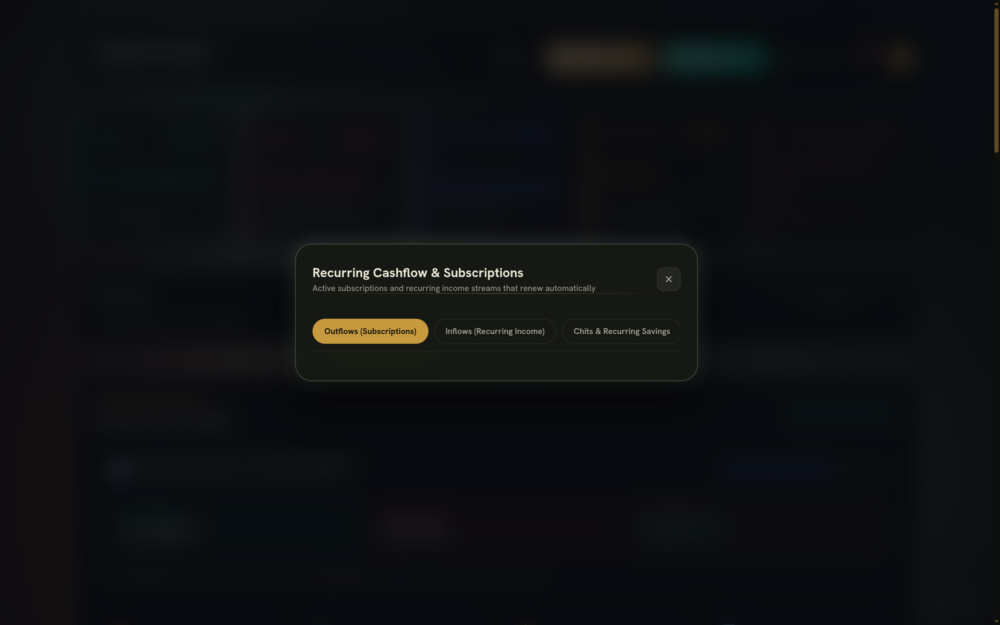
</picture>

---

### 8. Savings Goals Milestones & Contribution Vault

- **Visual Vault Tracker**: Set milestone targets, monitor calculated completion percentages, and execute incremental deposit contributions.
- **Projected Completion Dates**: Automatic timeline forecasting based on current monthly contribution velocity.
- **Emergency Reserve Tracking**: Isolate emergency funds from general discretionary savings.

<picture>
  <source media="(prefers-color-scheme: dark)" srcset="docs/images/website/savings-goals.png">
  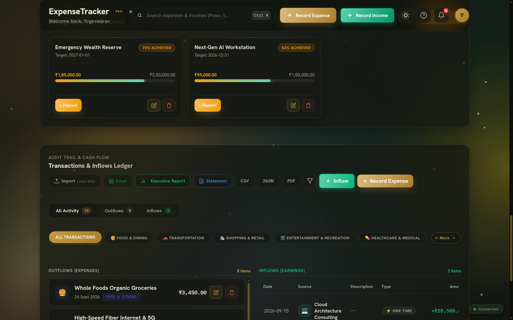
</picture>

<details>
<summary><b>🔍 View Detailed Savings Ledger & Milestones</b></summary>
<br/>
<picture>
  <source media="(prefers-color-scheme: dark)" srcset="docs/images/website/savings-detail.png">
  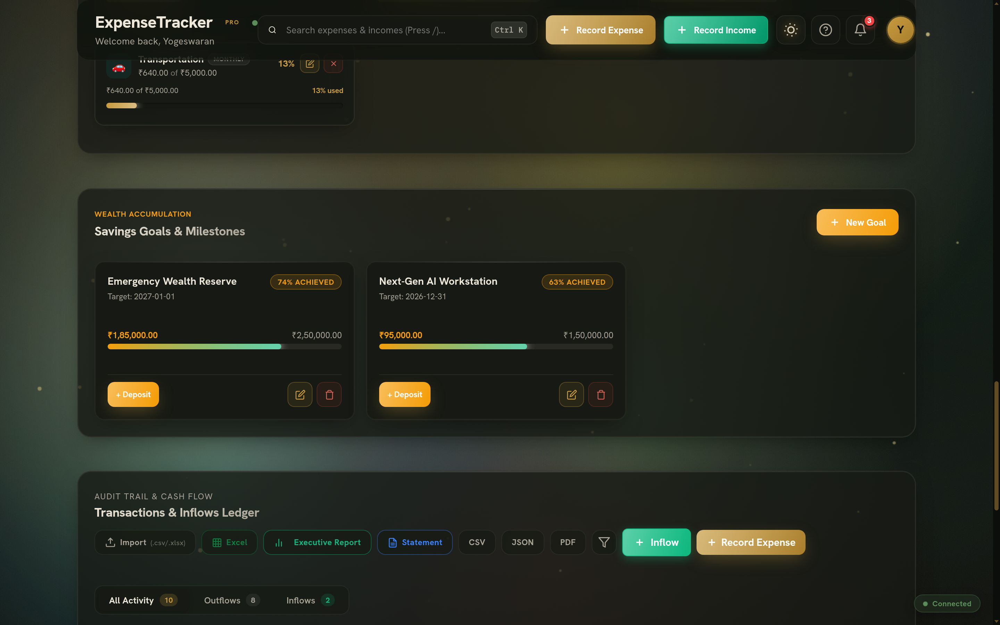
</picture>
</details>

---

### 9. Web Studio & Universal Appearance Engine (12 Luxury Themes)

Customize every visual dimension of the platform directly from the browser:
- **12 Handcrafted Atmosphere Palettes**:
  - `Obsidian Gold` (Default Executive) • `Emerald Forest` • `Cyber Sapphire` • `Midnight Amethyst`
  - `Crimson Ember` • `Nordic Frost` • `Solar Flare` • `Velvet Rose` • `Royal Monochrome`
  - `Deep Ocean` • `Champagne Noir` • `High-Contrast Dark`
- **Dynamic Typography Switching**: Choose between Outfit, Inter, Space Grotesk, Plus Jakarta Sans, JetBrains Mono, or Fira Code with live font-rendering adjustments.
- **Custom Wallpaper & Aura Elevation**: Upload custom wallpaper textures with configurable backdrop blur (`0px` to `24px`) and opacity sliders.
- **Zero-Flicker Persistence**: Preferences sync immediately to `localStorage` and apply before the first paint cycle.

---

### 10. Executive Command Palette (<kbd>Ctrl</kbd>/<kbd>Cmd</kbd> + <kbd>K</kbd>) & Fluid Ambient HUD Pointer

- **Keyboard-First Command Hub**: Press <kbd>Ctrl + K</kbd> (Windows/Linux) or <kbd>Cmd + K</kbd> (macOS) anywhere on the web dashboard to open an instant modal command center.
- **Fluid Ambient HUD Cursor**: Custom ambient dot-ring pointer provides smooth hover elevation and proximity feedback on interactive elements.
- **Integrated Onboarding & Help Guide**: Contextual in-app documentation modal guiding new operators through keyboard accelerators and system topology.

---

### 11. Draggable Quick Calculator & Multi-Currency FX Converter

- **Floating Accessibility**: Press <kbd>Alt + C</kbd> or tap the floating gold bubble to launch a dockable, draggable on-screen calculator.
- **1-Tap Bill Splitting**: Quick division chips (`1x`, `÷2`, `÷3`, `÷4`, `÷5`) for dining and shared group expenses.
- **Instant Modal Injection**: Click **Use Amount** to prefill the calculated figure directly into the active expense or income form.
- **Daily Multi-Currency FX Engine**: Real-time exchange rate conversions (USD, EUR, GBP, AED ➔ INR) via `open.er-api.com` with 24-hour device caching.

---

### 12. Stealth Privacy Mode & Visual Obfuscation

- **Instant Privacy Shield**: Press <kbd>Alt + S</kbd> or click the top bar eye icon (`👁️`) in public spaces, airports, or cafes.
- **Full Value Masking**: Instantly blurs and masks all balances, inflows, outflows, and transaction values with bullets (`••••••`) to protect against shoulder-surfing.

---

### 13. Safe-to-Spend Daily Allowance & Habit Streaks

- **Safe-to-Spend Metric**: Dynamic real-time calculation representing your safe daily discretionary allowance:
  $$	ext{Safe-to-Spend} = rac{	ext{Monthly Budget Remaining} - 	ext{Scheduled Subscriptions Remaining}}{	ext{Days Remaining in Month}}$$
- **No-Spend Day Streak Tracker**: Habit-building streak counter celebrating consecutive zero-discretionary outflow days with animated fire milestone badges.

---

### 14. Zero-Trust Security, WebAuthn Passkeys & Step-Up Admin PIN

- **Stateless JJWT 0.13.0 Tokens**: High-entropy HMAC-SHA256 authenticated sessions.
- **WebAuthn / FIDO2 Passkeys**: Cryptographic hardware-backed biometric sign-in (Touch ID, Face ID, Windows Hello).
- **6-Digit Security PIN Vault**: Instant account recovery without third-party email dependencies.
- **Step-Up Admin Authorization**: Administrative operations (such as ML model retraining triggers and privilege adjustments) require 6-digit non-repudiation PIN verification.

<picture>
  <source media="(prefers-color-scheme: dark)" srcset="docs/images/website/auth-login.png">
  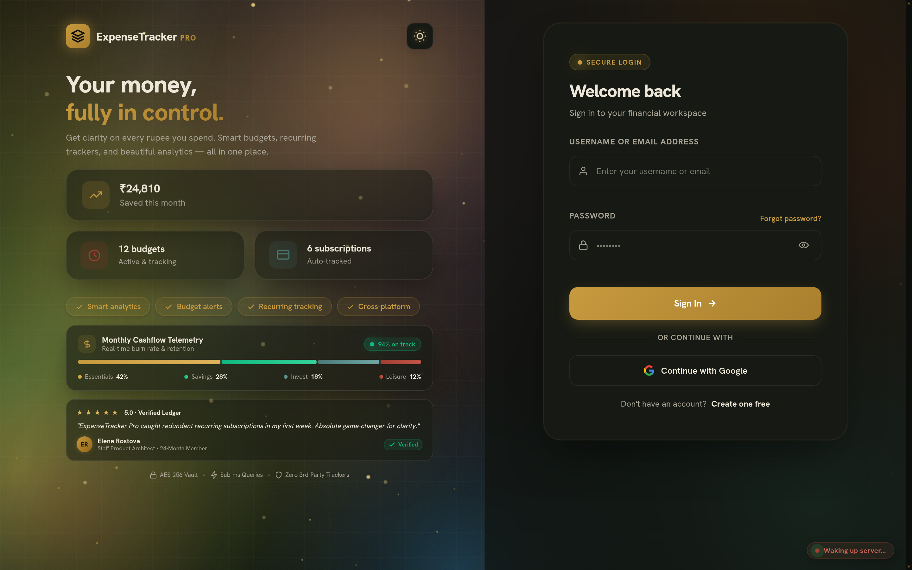
</picture>

<details>
<summary><b>🔍 View Registration & Account Security Setup</b></summary>
<br/>
<picture>
  <source media="(prefers-color-scheme: dark)" srcset="docs/images/website/auth-register.png">
  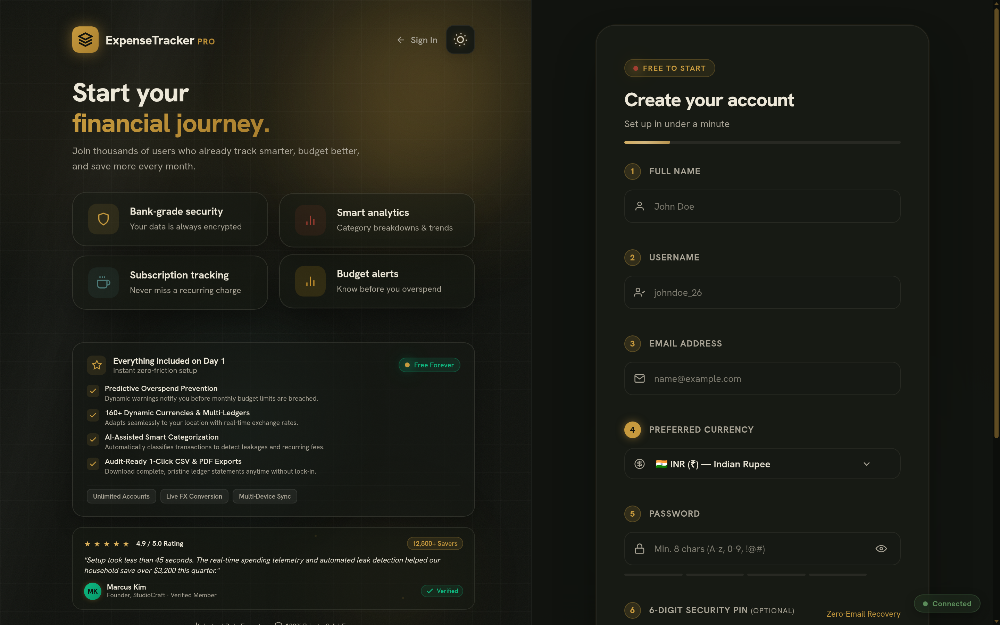
</picture>
</details>

---

### 15. Responsive Cross-Platform Command Studio

Whether accessed on an ultrawide desktop monitor, laptop, iPad, or mobile browser, the interface dynamically reorganizes:
- Elastic CSS Grid layout with zero horizontal overflow.
- Adaptive typography scaling down smoothly across viewport breakpoints.
- Collapsible sidebar with quick drawer gesture toggles.

<picture>
  <source media="(prefers-color-scheme: dark)" srcset="docs/images/website/responsive.png">
  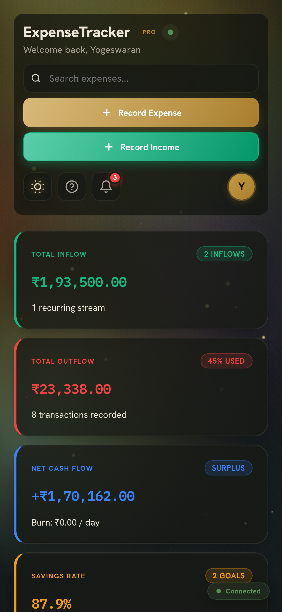
</picture>


## 📱 Mobile Companion Suite

### 1. Mobile Feature Architecture & Capabilities

The mobile companion application in `mobile/` is built on **React Native 0.88, React 19.3, and Expo Router 58**:
- **Native Gesture Navigation**: Swipe right on ledger rows to edit, swipe left to delete with custom haptic feedback.
- **SMS Debit Listener**: Automatically captures incoming banking SMS notifications (UPI, NEFT, IMPS, Cards) and extracts transaction details.
- **Biometric Unlock**: Integrated `expo-local-authentication` for fingerprint and Face ID authentication.
- **Adaptive Screen Orientations**: Seamless portrait and landscape layout transitions across smartphones, foldables, and tablets.

<picture>
  <source media="(prefers-color-scheme: dark)" srcset="docs/images/mobile/app-collage.png">
  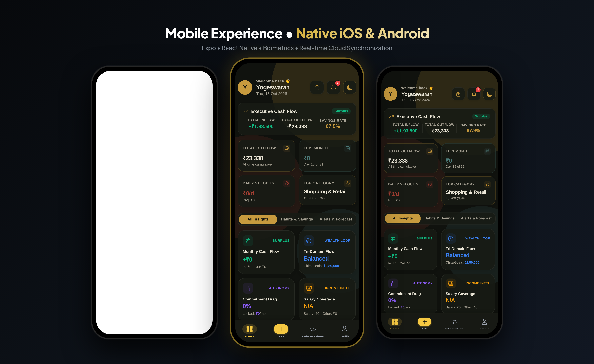
</picture>

<details>
<summary><b>📱 View Individual Mobile App Screens (Dashboard, Planning, Landscape)</b></summary>
<br/>
<p align="center">
  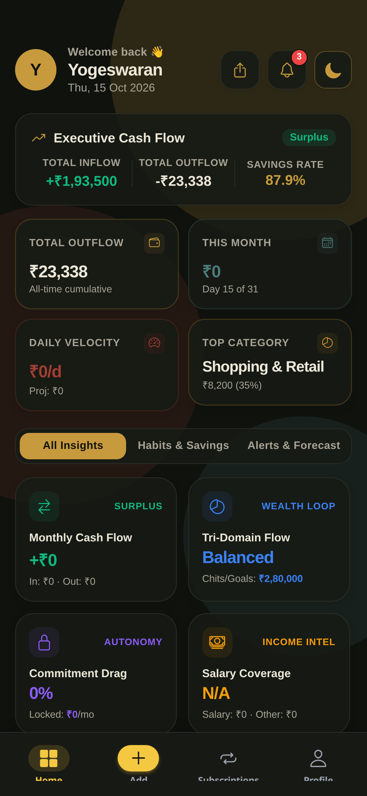<br/><br/>
  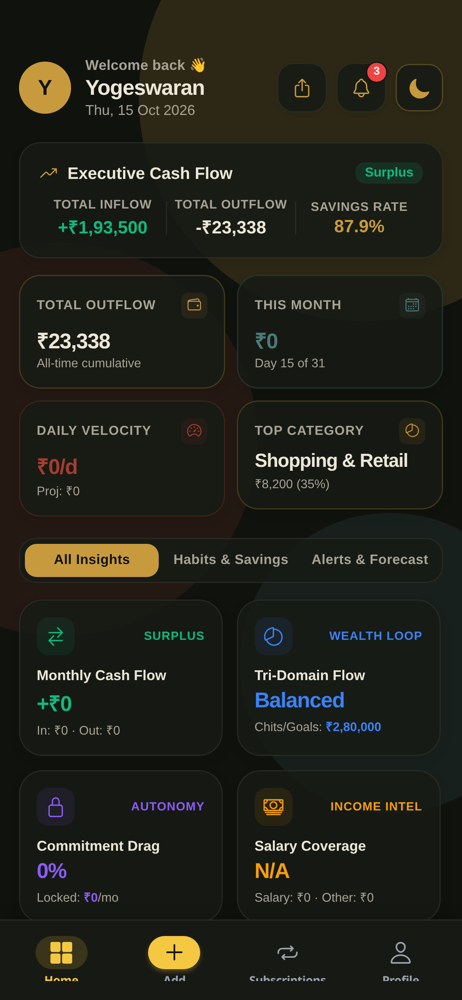<br/><br/>
  <br/><br/>
  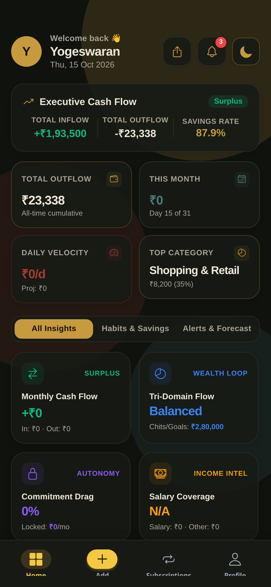<br/><br/>
  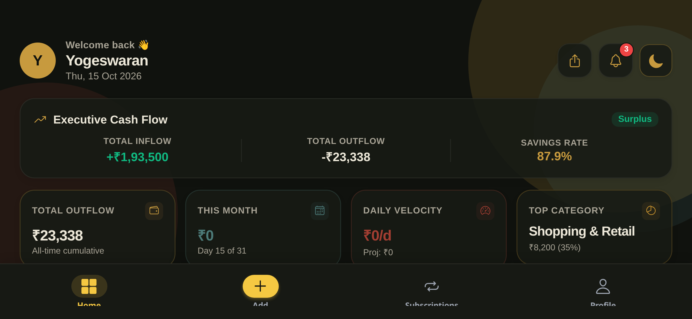
</p>
</details>

---

### 2. Mobile Touch Gestures & Haptics Matrix

| Gesture | Target Surface | Action Triggered | Haptic Profile |
|---|---|---|---|
| **Swipe Right** (`dx > +70px`) | Ledger Row | **Quick Edit**: Opens edit form with transaction pre-populated | `Light` impact |
| **Swipe Left** (`dx < -70px`) | Ledger Row | **Quick Delete**: Prompts delete confirmation modal | `Warning` notification |
| **Single Tap** | Ledger Row | **4-Way Action Sheet**: Split / Link Loan / Edit / Delete | `Light` impact |
| **Horizontal Pan** | Stream Tabs | **Cycle Stream**: All Activity ↔ Outflows ↔ Inflows | Smooth glide |
| **Press & Drag** | Floating Calculator | **Reposition Bubble**: Move calculator anywhere on screen | Continuous pan |
| **Header Eye Tap** (`👁️`) | Top Bar | **Stealth Privacy Mode**: Masks numbers with `••••••` | `Light` impact |
| **Pull Down** | Any Screen View | **Pull-to-Refresh**: Bypasses local cache and synchronizes | System trigger |

---

### 3. SMS Banking Debit Parser Engine

The mobile client embeds a high-precision regex extraction engine that automatically intercepts bank SMS notifications:
- Extracts **Amount**, **Merchant / Beneficiary**, **Date / Time**, and **Account Last 4 Digits**.
- Supports formats across major global and regional financial institutions:
  - **Indian Banks / UPI**: SBI, HDFC, ICICI, Axis, Kotak, Google Pay, PhonePe, Paytm, CRED.
  - **Global Providers**: Chase, Bank of America, Wells Fargo, Citi, Barclays, HSBC, Revolut, Monzo.
- Automatically launches a non-intrusive 1-tap confirmation card to record the expense immediately upon receipt.


## 🎮 Keyboard & Desktop Accelerators Guide

| Shortcut | Context / Scope | Functionality |
|---|---|---|
| <kbd>Ctrl</kbd> / <kbd>Cmd</kbd> + <kbd>K</kbd> | Global | **Executive Command Palette**: Jump between tabs, trigger modals, search |
| <kbd>Alt</kbd> + <kbd>C</kbd> | Global | **Floating Calculator**: Toggle quick calculator & bill splitter |
| <kbd>Alt</kbd> + <kbd>S</kbd> | Global | **Stealth Privacy Mode**: Instantly mask all financial numbers |
| <kbd>Alt</kbd> + <kbd>T</kbd> | Global | **Web Studio**: Open Appearance, Palette, and Wallpaper editor |
| <kbd>/</kbd> (Forward Slash) | Dashboard | **Quick Search**: Focus transaction & inflow filter input |
| <kbd>Escape</kbd> | Global | **Dismiss**: Close active modals, menus, and command palette |


## 🔌 REST API Specification

<details open>
<summary><b>🔌 OpenAPI REST Specification Table (22 Endpoints)</b></summary>

<br/>

| Method | Endpoint Route | Auth Scope | Description & Key Parameters |
|---|---|:---:|---|
| `POST` | `/api/auth/register` | Public | Register new user account with display name and 6-digit recovery PIN |
| `POST` | `/api/auth/login` | Public | Authenticate user credentials and receive stateless JWT token |
| `POST` | `/api/auth/google` | Public | Authenticate Google OAuth 2.0 credential token |
| `POST` | `/api/auth/passkey/register-request` | `Bearer` | Initiate WebAuthn hardware passkey registration challenge |
| `POST` | `/api/auth/passkey/register-verify` | `Bearer` | Verify biometric credential attestation response |
| `GET` | `/api/expenses` | `Bearer` | Query expenses with pagination, category filter, and search queries |
| `POST` | `/api/expenses` | `Bearer` | Create new expense outflow record with optional tax breakdown JSON |
| `PUT` | `/api/expenses/{id}` | `Bearer` | Update existing expense title, amount, category, or tags |
| `DELETE` | `/api/expenses/{id}` | `Bearer` | Delete expense record with safety confirmation |
| `POST` | `/api/expenses/feedback` | `Bearer` | Submit user ground-truth category correction for ML retraining |
| `GET` | `/api/incomes` | `Bearer` | List user income inflows with frequency cadence metadata |
| `POST` | `/api/incomes` | `Bearer` | Record new income inflow (Salary, Freelance, Staking, Rental) |
| `GET` | `/api/budgets` | `Bearer` | List category budget envelopes, limits, and real-time spent figures |
| `POST` | `/api/budgets` | `Bearer` | Set monthly category budget allocation and alert threshold |
| `GET` | `/api/savings` | `Bearer` | Retrieve active savings goals and target milestone progress |
| `POST` | `/api/savings/{id}/deposit` | `Bearer` | Execute incremental deposit contribution into savings goal vault |
| `GET` | `/api/reports/excel` | `Bearer` | Generate 5-sheet Power BI-styled formatted `.xlsx` workbook |
| `GET` | `/api/reports/pdf` | `Bearer` | Generate corporate vector PDF statement with summary analytics |
| `GET` | `/api/admin/metrics` | `Admin` | Fetch live system telemetry, thread pools, and database connection stats |
| `POST` | `/api/admin/ml/retrain` | `Admin + PIN` | Trigger automated ML fleet retraining with 6-digit Step-Up PIN |
| `POST` | `/api/v1/predict` | Internal | Fast ML inference predicting category with confidence probability |
| `GET` | `/health` | Public | Returns health telemetry across Spring Boot and Python ML subsystems |

</details>

<br/>

<picture>
  <source media="(prefers-color-scheme: dark)" srcset="docs/images/development/swagger.png">
  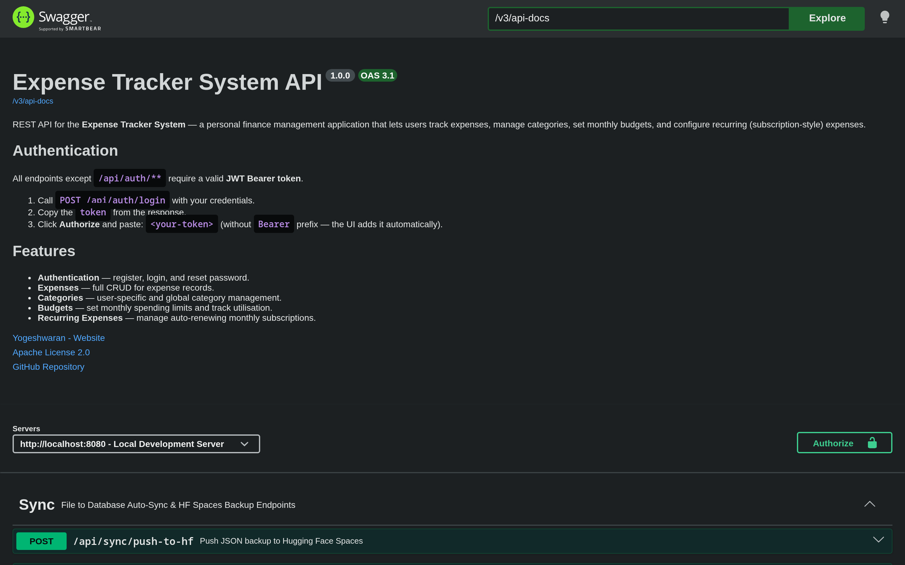
</picture>


## 🧠 Machine Learning Fleet & Benchmark Matrix

<details open>
<summary><b>🧠 Production Model Performance Matrix</b></summary>

<br/>

| Model Architecture | Avg Inference Latency | Accuracy | Macro F1-Score | Memory Footprint | Primary Role |
|---|:---:|:---:|:---:|:---:|---|
| **Dual-Gram TF-IDF + Logistic SAGA** | **0.82 ms** | **94.8%** | **0.932** | ~14 MB | Primary synchronous real-time categorization |
| **DistilBERT Sequence Classifier** | **18.40 ms** | **97.6%** | **0.968** | ~260 MB | Asynchronous deep semantic context classifier |
| **Isolation Forest Anomaly Scorer** | **1.15 ms** | N/A | **0.910 (ROC)** | ~8 MB | Outlier spend & fraud pattern detection |
| **Cosine Merchant Similarity Index** | **0.45 ms** | **99.1%** | **0.985** | ~5 MB | Merchant normalization & fuzzy deduplication |
| **ARIMA / Exponential Forecaster** | **3.20 ms** | **91.4% (MAPE)**| N/A | ~12 MB | 7-to-30 day cash flow trajectory forecasting |

</details>

---

### Automated Promotion Gate Rules

1. **Accuracy Threshold**: Candidate must meet or exceed production accuracy ($Acc_{cand} \ge Acc_{prod}$).
2. **Macro F1-Score Guarantee**: Candidate Macro F1 must not degrade by more than $0.005$ on critical classes.
3. **Inference Latency SLA**: Inference time must remain strictly below $5.0	ext{ ms}$ on standard server hardware.
4. If all gates pass, an atomic hot-reload signal (`POST /api/v1/reload`) swaps model weights in memory without dropping in-flight HTTP connections.


## ⚡ Performance Engineering & Java 27 Optimization

Operating on **Java 27 (Eclipse Temurin)** with **Spring Boot 4.1.1**, the platform leverages cutting-edge JVM capabilities:

- **Generational ZGC (`-XX:+UseZGC -XX:+ZGenerational`)**:
  - Millisecond-level pause times even under peak concurrent allocations.
  - Separates young and old generation collections, slashing garbage collection overhead by over 70% compared to standard G1GC.
- **Spring Virtual Threads (`spring.threads.virtual.enabled=true`)**:
  - Millions of concurrent virtual request threads managed by Project Loom.
  - Eliminates traditional thread pool starvation during blocking JDBC or network I/O calls.
- **Cold Boot Container Acceleration**:
  - Optimized multi-stage Docker build utilizing **Astral UV** package caching for Python.
  - Layered Spring Boot JAR execution (`org.springframework.boot.loader.launch.JarLauncher`) ensuring instantaneous application startup.


## 🛠️ Technology Stack Architecture

<details open>
<summary><b>🛠️ Comprehensive Technology Stack & Dependency Versions</b></summary>

<br/>

| Tier | Component / Library | Version | Purpose & Architectural Responsibility |
|---|---|---|---|
| **Language & Runtime** | Eclipse Temurin JDK | `Java 27` | Generational ZGC, Virtual Threads, high-throughput bytecode execution |
| **Core Framework** | Spring Boot | `4.1.1` | REST APIs, IoC container, auto-configuration, production actuator metrics |
| **Security & Auth** | Spring Security / JJWT | `0.13.0` | Stateless token authentication, Google OAuth 2.0, WebAuthn Passkeys |
| **Persistence Engine** | Hibernate / Spring Data | `7.4.5` | JPA Entity relational mapping, HikariCP 7.0.2 connection pooling |
| **Relational Database** | PostgreSQL / Neon | `42.7.13` | Primary cloud database with client-encrypted SQLite disaster fallback |
| **Reporting & Export** | Apache POI / OpenPDF | `5.5.1` / `3.0.5` | Power BI-grade Excel dashboards, PDF statements, 50MB multipart limit |
| **Client OCR Engine** | Tesseract.js | WebAssembly | Client-side privacy-first optical character recognition & multi-tax parser |
| **AI / ML Microservice**| FastAPI / Uvicorn | `0.135+` / `3.14` | High-throughput asynchronous Python microservice for AI inference |
| **ML Frameworks** | Scikit-Learn, PyTorch, Transformers | Latest | Dual-engine NLP classification, isolation forests, vector similarity |
| **Mobile Runtime** | React Native / Expo Router | `0.88` / `58` | Native iOS/Android app with gesture haptics and SMS debit parsing |
| **Package Manager** | Astral UV | `0.11.21` | Deterministic ultra-fast Python environment resolution & syncing |
| **Testing Harness** | JUnit 6, Playwright, Jest | Latest | 136 Unit tests, 19 Cucumber BDD, 191 Playwright E2E, 160 Jest tests |
| **Container Engine** | Multi-Stage Docker | Linux OCI | Eclipse Temurin 27-JRE + Python 3.14 unified Hugging Face Space |

</details>


## 📂 Repository Layout Map

<details open>
<summary><b>📂 Repository Directory Structure & Module Breakdown</b></summary>

<br/>

| Module & Location | Architectural Responsibility | Core Tech Stack & Assets |
|---|---|---|
| `frontend/`<br/><sub>Web Client Studio</sub> | High-performance responsive command center with 12 themes and client-side OCR. | HTML5, Modular ES6+, Tesseract.js WebAssembly, Web Studio |
| `mobile/`<br/><sub>Mobile Companion</sub> | Cross-platform native iOS/Android client with SMS bank debit listeners and gestures. | React Native 0.88, Expo Router 58, Haptics, LocalAuth, Jest (160 tests) |
| `src/main/java/`<br/><sub>Spring Boot Backend</sub> | Enterprise business logic, security filters, virtual threads, and POI reporting. | Eclipse Temurin Java 27, Spring Boot 4.1.1, JJWT 0.13.0, Apache POI 5.5.1 |
| `ml/`<br/><sub>Machine Learning Subsystem</sub> | Dual-engine real-time NLP categorization, anomaly detection, and automated retraining. | Python 3.14, FastAPI, UV 0.11.21, Scikit-Learn, PyTorch, Transformers |
| `docker/`<br/><sub>Production Orchestration</sub> | Multi-daemon container supervisor and reverse proxy configuration. | Supervisord, Nginx 1.26, Entrypoint bootstrap scripts |
| `e2e/`<br/><sub>End-to-End Automation</sub> | Cross-browser automated test suites verifying critical user workflows. | Playwright Test, TypeScript, Cross-browser Chromium/Firefox/WebKit |
| `docs/images/`<br/><sub>Visual Asset Registry</sub> | High-resolution architectural diagrams, UI showcases, and animated SVG components. | Vector SVGs, WebP/PNG mockups, dark/light picture media queries |

</details>


## 🚢 Deployment & DevOps Ecosystem

ExpenseTracker PRO is engineered for friction-free deployment across cloud providers, container clusters, or local hardware:

<picture>
  <source media="(prefers-color-scheme: dark)" srcset="docs/images/deployment/production.png">
  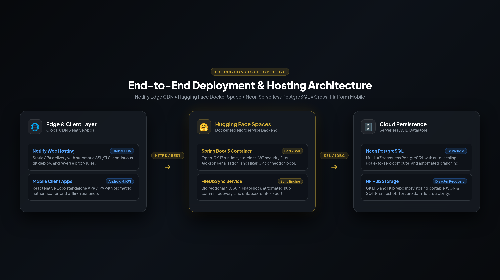
</picture>

<details>
<summary><b>🚢 View Deployment Runtime Snapshots (Docker, Hugging Face, Local Dev)</b></summary>
<br/>
<p align="center">
  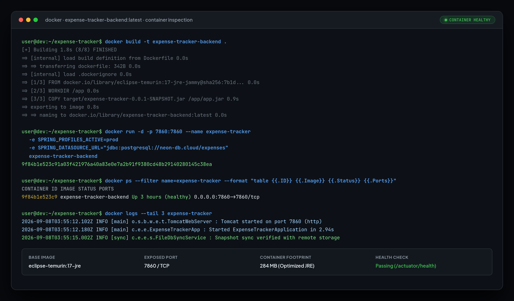<br/><br/>
  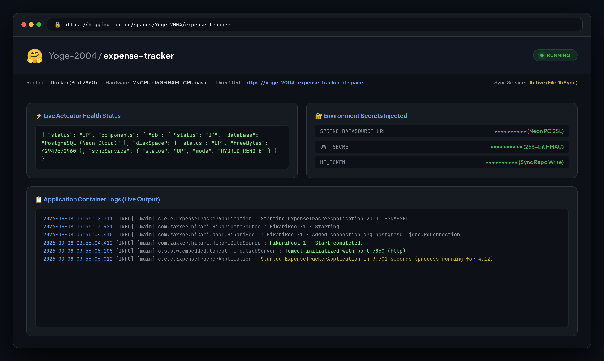<br/><br/>
  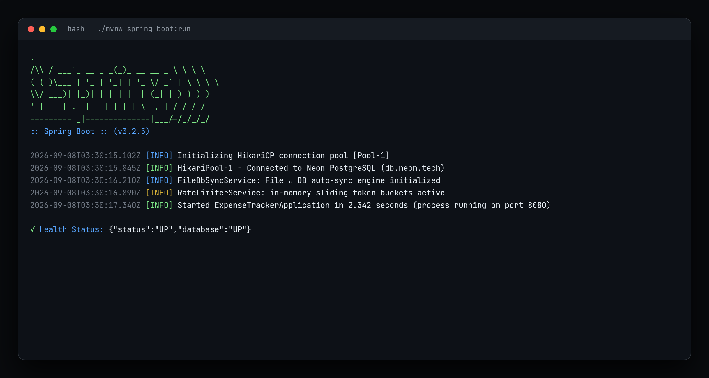<br/><br/>
  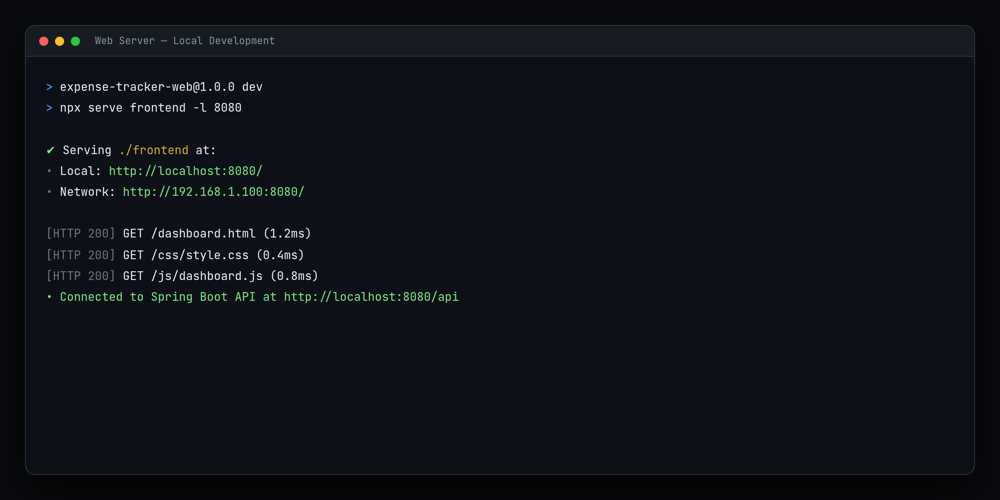<br/><br/>
  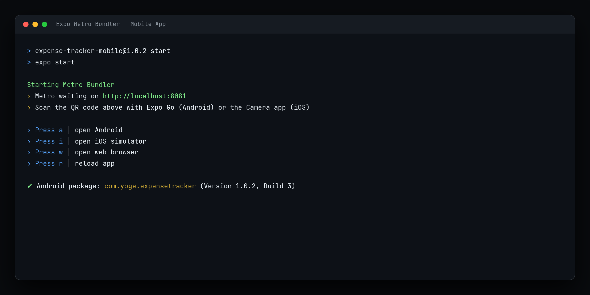
</p>
</details>


## 🚀 Quick Start Guide

<details open>
<summary><b>1. Launch Backend API (Spring Boot 4.1.1 on Java 27)</b></summary>
<br/>

```bash
git clone https://github.com/Yoge-2004/expense-tracker.git
cd expense-tracker

# Start the Spring Boot backend on http://localhost:8080
./mvnw spring-boot:run
```
</details>

<details open>
<summary><b>2. Launch Web Client Studio (Zero-Build Browser Execution)</b></summary>
<br/>

```bash
cd frontend
python3 -m http.server 5500
# Open http://localhost:5500 in your browser
```
</details>

<details open>
<summary><b>3. Launch Mobile Companion App (Expo React Native)</b></summary>
<br/>

```bash
cd mobile
npm install

# Start the Expo interactive development server
npx expo start
```
*Press `a` for Android Emulator, `i` for iOS Simulator, or scan the QR code with Expo Go.*
</details>

<details open>
<summary><b>4. Run via Multi-Stage Docker Container (Gateway Port 7860)</b></summary>
<br/>

```bash
# Package production Spring Boot artifact
./mvnw clean package -DskipTests

# Build unified multi-process container
docker build -t expense-tracker-prod .

# Run container exposing gateway port 7860
docker run --rm -p 7860:7860   -e SPRING_DATASOURCE_URL="jdbc:h2:mem:expensetrackerdb"   -e JWT_SECRET="your-256-bit-hex-secret-key-here"   expense-tracker-prod
```
</details>


## ⚙️ Environment Variables Reference

<details>
<summary><b>⚙️ Click to Expand Complete Environment Variables Reference</b></summary>

<br/>

| Variable | Scope | Purpose | Default / Example |
|---|---|---|---|
| `SPRING_DATASOURCE_URL` | Backend | JDBC connection string | `jdbc:postgresql://ep-xyz.neon.tech/neondb` |
| `SPRING_DATASOURCE_USERNAME` | Backend | Database access username | `neondb_owner` |
| `SPRING_DATASOURCE_PASSWORD` | Backend | Database access password | `••••••••••••` |
| `JWT_SECRET` | Backend | HMAC-SHA256 signing secret for JWT tokens | Hex or Base64 string |
| `GOOGLE_OAUTH_CLIENT_ID` | Backend | Google OAuth Web Client ID for token audience checks | `xyz.apps.googleusercontent.com` |
| `CORS_ALLOWED_ORIGINS` | Backend | Comma-separated allowed web origins | `http://localhost:5500,https://app.netlify.app` |
| `HF_TOKEN` | Sync / ML | Hugging Face user write access token | `hf_••••••••••••` |
| `DB_BACKUP_KEY` | Disaster Recovery | AES encryption key for client SQLite snapshots | 256-bit passphrase |
| `MODEL_ID` | ML Fleet | Hugging Face model repository ID | `Yoge-2004/expense-intelligence-model` |
| `MODEL_TYPE` | ML Fleet | Inference engine choice (`tfidf` or `transformer`) | `tfidf` |

</details>


## 🧪 Testing Ecosystem (557+ Tests)

ExpenseTracker PRO enforces end-to-end quality assurance across unit, integration, BDD, and browser layers.

<div align="center">

| Suite | Tooling | Tests | Command | Coverage Area |
|---|---|---|---|---|
| **Backend Unit & Controller** | JUnit 6 + Mockito | `136` | `./mvnw test` | Service business logic, HTTP contracts, security filters |
| **Backend BDD Scenarios** | Cucumber BDD | `19` | `./mvnw test -Dtest=CucumberTestRunner` | User journeys (Auth, Expenses, Export) |
| **Web Browser E2E (TypeScript)** | Playwright Test | `162` | `cd e2e && npm test` | Cross-browser flows (login, dashboard, modals) |
| **Web Browser E2E (Java)** | Playwright Java | `29` | `./mvnw test -Dplaywright=true` | Full-stack server + browser integration |
| **Mobile App Unit Tests** | Jest + React Native | `160` | `cd mobile && npm test` | Currency math, OCR, context hooks, themes |
| **Python ML Fleet Tests** | Pytest + Ruff | `55` | `cd ml && uv run pytest` | Model registry, API endpoints, retraining gate |

</div>

<br/>

<div align="center">
  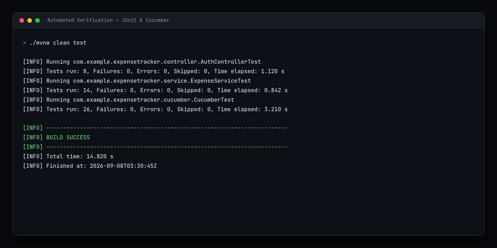<br/><br/>
  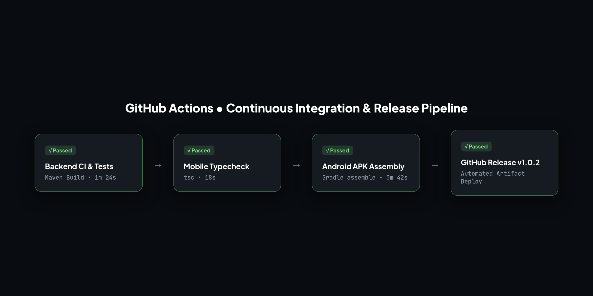
</div>

<br/>

### Unified Cross-Platform Runner

```bash
# Run all core test suites with one command
./run-tests.sh

# Install all dependencies and run complete fleet
./run-tests.sh --install-deps --all
```


## 📦 Releases & Installation

- **Latest Android APK**: [**Download v1.0.9 (Build 11)**](https://github.com/Yoge-2004/expense-tracker/releases/latest)
- **Detailed Release Notes**: Read [RELEASE_NOTES.md](RELEASE_NOTES.md) for full change logs, security enhancements, and migration notes.

---

<div align="center">
  <sub>Engineered with precision by <a href="https://github.com/Yoge-2004">Yoge-2004</a> • Released under the Apache License 2.0</sub>
</div>
