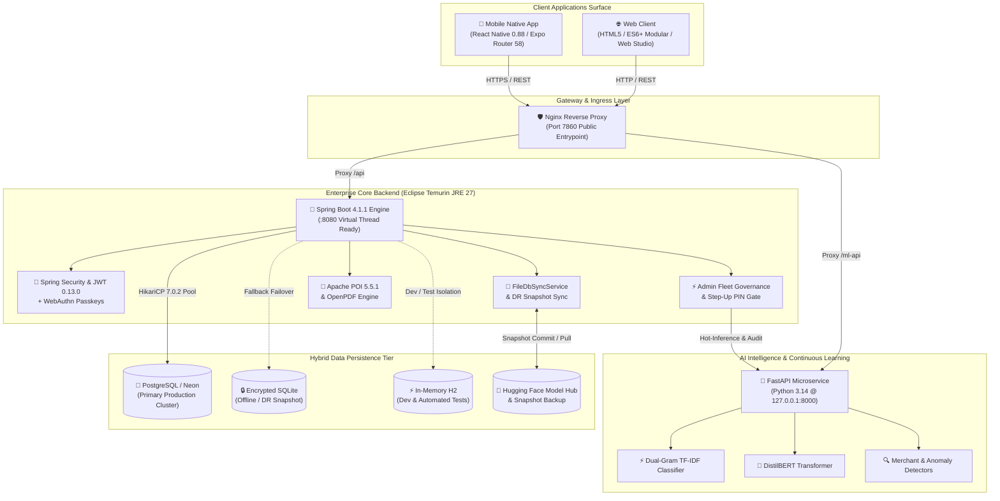
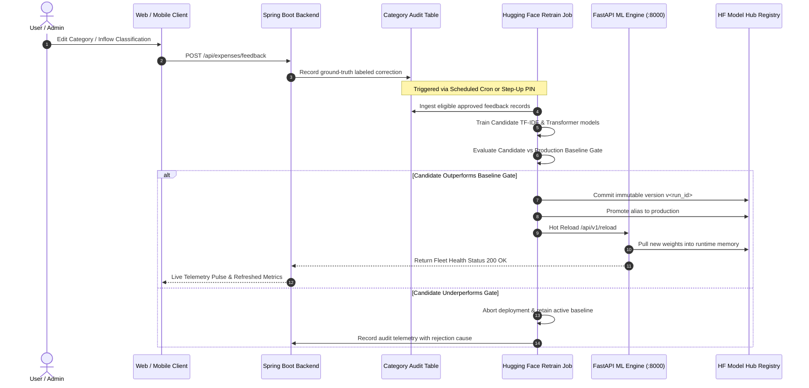
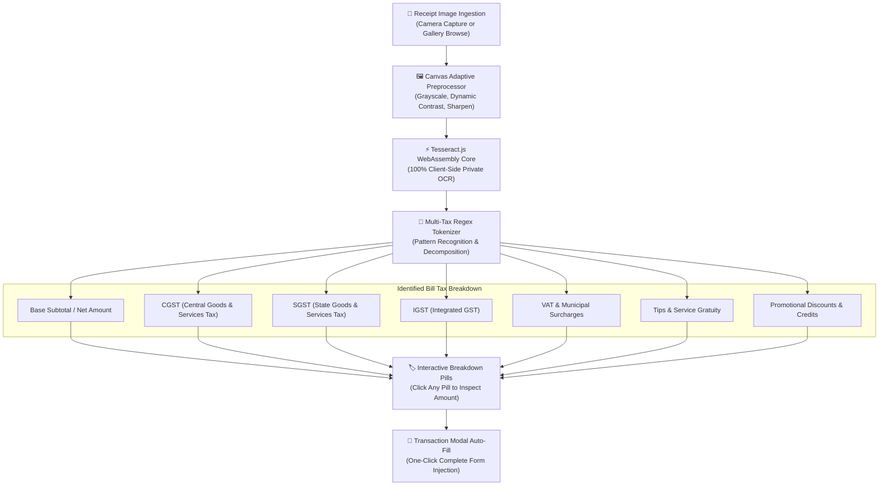

<div align="center">


<br/>

<a href="https://github.com/Yoge-2004/expense-tracker">
  
</a>

<br/>

<p align="center">
  <a href="https://github.com/Yoge-2004/expense-tracker/actions/workflows/ci.yml">
    
  </a>
  <a href="https://github.com/Yoge-2004/expense-tracker/actions/workflows/android-apk.yml">
    
  </a>
  <a href="https://huggingface.co/spaces/Yoge-2004/expense-tracker-backend">
    
  </a>
  <a href="https://github.com/Yoge-2004/expense-tracker/releases/latest">
    
  </a>
  <a href="LICENSE">
    
  </a>
</p>

<p align="center">
  <b>Enterprise-Grade Personal Finance Workspace • Synchronized Cross-Platform Engine</b>
  <br/>
  <a href="#-enterprise-architecture--system-topology">Architecture</a> •
  <a href="#-product-at-a-glance">Features</a> •
  <a href="#-machine-learning--continuous-intelligence-fleet">ML Fleet</a> •
  <a href="#-multi-tax-receipt-ocr-scanner">Receipt OCR</a> •
  <a href="#-run-the-web--backend-locally">Quickstart</a> •
  <a href="#-testing-ecosystem">Testing</a>
</p>


</div>

## 🌟 Executive Overview

**ExpenseTracker PRO** is a full-stack, enterprise-grade financial intelligence ecosystem engineered with performance-first principles. Built on **Java 27** using Generational ZGC, **Spring Boot 4.1.1**, **Python 3.14**, and **Expo React Native**, the platform unifies real-time cash flow recording, multi-tax receipt OCR, dual-engine machine learning categorization, and executive telemetry governance into an atomic, coherent workspace.

```
┌──────────────────────────────────────────────────────────────────────────────────┐
│  🌐 Web Studio (HTML5 / ES6+ Custom Atmosphere & Theme Performance Engine)        │
│  📱 Mobile Suite (Expo 58 / React Native 0.88 / Native Haptics & Biometrics)     │
│  ⚙️ Core API (Spring Boot 4.1.1 / Java 27 / JJWT 0.13.0 / WebAuthn Passkeys)      │
│  🧠 ML Microservice (Python 3.14 / FastAPI / TF-IDF + Transformer Retraining)    │
│  💾 Hybrid Persistence (PostgreSQL / Neon / Encrypted SQLite DR Snapshots / H2)  │
└──────────────────────────────────────────────────────────────────────────────────┘
```

<picture>
  <source media="(prefers-color-scheme: dark)" srcset="docs/images/website/hero-dashboard.png">
  <source media="(prefers-color-scheme: light)" srcset="docs/images/website/hero-dashboard.png">
  
</picture>


## 🧭 Product at a Glance

| Domain | Capabilities & Engineering Innovations |
|---|---|
| **💰 Unified Cash Flow Ledger** | Chronological dual-stream ledger combining expense outflows and income inflows with sub-millisecond filtering, multi-column sorting, and inline editing. |
| **🧾 Multi-Tax Receipt OCR** | Dual-mode Tesseract.js scanner operating 100% client-side. Automatically identifies and decomposes Subtotal, CGST, SGST, IGST, VAT, Tips, and Discounts into interactive prefill pills. |
| **🧠 Continuous ML Fleet** | Dual-engine categorization (TF-IDF SAGA + DistilBERT Transformer), SMS bank debit notification listener, interactive prediction playground, and Hugging Face automated retraining loop. |
| **📊 Power BI Excel Hub** | Executive POI-generated Excel workbooks styled after Microsoft Power BI, featuring KPI cards, distribution matrices, formatted tables, and PDF statement generation. |
| **🎨 Web Studio & Atmosphere** | Live customizable UI engine supporting dynamic palettes, custom font uploads via FontFace API, background image wallpapers with configurable blur and opacity, and atomic theme switching. |
| **🛡️ Zero-Trust Security** | Stateless JWT authentication, Google OAuth 2.0 verification, WebAuthn/FIDO2 passkey biometric sign-in, Step-Up Admin PIN protection, and shoulder-surfing Stealth Privacy Mode (`Alt+S`). |
| **📈 Dynamic Budget Guardrails** | Category spending caps with velocity burn metrics, Safe-to-Spend daily allowances, and visual habit-building No-Spend Day streak milestones. |
| **🧮 Draggable Quick Calculator** | Floating dockable calculator (`Alt+C`) with precision math, 1-tap bill splitting (`÷2` to `÷5`), and live daily FX conversions across USD, EUR, GBP, AED, and INR. |
| **💾 Multi-Tier Resilience** | PostgreSQL / Neon primary, client-side encrypted SQLite snapshot failover (`expense_tracker.sqlite.enc`), 50MB chunked memory streaming, and zero-downtime offline caching. |


## 🏗️ Enterprise Architecture & System Topology

The platform implements a distributed, decoupled multi-service architecture designed for high throughput, sub-10ms response times, and automated failure recovery.

### 1. High-Level Distributed Infrastructure



---

### 2. Spring Boot Layered Architecture (IntelliJ Component Decomposition)

The backend code is organized into strict architectural boundaries ensuring single-responsibility decoupling and unit testability:


---

### 3. Continuous ML Fleet Retraining & Feedback Loop

ExpenseTracker PRO continuously trains its categorization models on ground-truth user corrections through an immutable, gated pipeline:



---

### 4. Client-Side Dual-Mode OCR & Multi-Tax Decomposition




## 🔬 Core System Features

<details open>
<summary><b>🧾 1. Multi-Tax Receipt OCR Scanner (Client-Side Privacy)</b></summary>
<br/>

The receipt scanner operates entirely inside the client’s browser using WebAssembly-powered Tesseract.js. No receipt photographs or sensitive merchant invoices are ever transmitted to third-party cloud APIs.

- **Dual Ingestion**: Drag-and-drop receipt image files or activate real-time device camera scanning.
- **Granular Tax Extraction**: Intelligently identifies individual line items:
  - Base Subtotal / Net Amount
  - CGST, SGST, IGST (Indian GST Structure)
  - VAT & Hospitality Service Taxes
  - Service Charges, Gratuities & Delivery Fees
  - Negative deductions and coupon discounts (`-10%`, `-₹120.00`)
- **1-Click Modal Prefill**: Visual pills appear below the scanner. Clicking any pill pre-populates the expense amount, merchant name, and categorization modal instantly.

<picture>
  <source media="(prefers-color-scheme: dark)" srcset="docs/images/website/add-expense.png">
  
</picture>
</details>

<details>
<summary><b>🧠 2. AI Machine Learning Continuous Intelligence Fleet</b></summary>
<br/>

- **Dual-Model Categorization Architecture**:
  - **TF-IDF + Logistic Regression (SAGA)**: Microsecond baseline inference for known merchants and recurring descriptions.
  - **DistilBERT Transformer**: Deep contextual text understanding on ambiguous, informal, or complex merchant statements.
- **Automated SMS Debit Parsing**: Mobile listener captures bank SMS alerts (UPI, NEFT, IMPS, Visa, Mastercard) and auto-populates financial entries without manual typing.
- **Executive Retraining Governance**: Platform administrators can inspect model accuracy, drift telemetry, sample sizes, and manually trigger retraining with 6-digit Step-Up PIN authentication.

<picture>
  <source media="(prefers-color-scheme: dark)" srcset="docs/images/website/dashboard.png">
  
</picture>
</details>

<details>
<summary><b>📊 3. Power BI-Grade Excel Analytics & Data Hub</b></summary>
<br/>

- **Executive Excel Reports**: Generates multi-sheet workbooks styled to modern Microsoft Power BI standards using Apache POI:
  - Executive KPI Summary Cards (Total Inflows, Outflows, Net Balance, Savings Velocity)
  - Categorized breakdown distributions with formatted percentage metrics
  - High-density tabular ledgers with currency formatting and status tags
- **Bidirectional Data Hub**: High-throughput Excel and CSV import/export pipeline supporting up to 50MB and 500,000+ rows with streaming memory safety.

<picture>
  <source media="(prefers-color-scheme: dark)" srcset="docs/images/website/reports.png">
  
</picture>
</details>

<details>
<summary><b>🎨 4. Web Studio & Appearance Customization Engine</b></summary>
<br/>

- **Custom Wallpaper Atmosphere**: Upload personalized background images or select from 6 curated luxury presets with adjustable blur (0–20px) and opacity (0.0–0.9).
- **Dynamic Color Palettes**: Extract dominant palettes automatically or customize `--primary`, `--accent`, and `--highlight` tokens with real-time CSS variable cascading.
- **Typography Engine**: Choose between **Hanken Grotesk**, **Fraunces**, **IBM Plex Mono**, or upload custom `.woff2`/`.ttf` font files dynamically via the FontFace API.
- **Atomic Theme Guard**: Suppresses multi-node transition bursts during theme swaps, ensuring 60fps frame rates across huge financial ledgers.
</details>

<details>
<summary><b>🎮 5. High-Velocity Gestures & Keyboard Shortcuts Guide</b></summary>
<br/>

### 📱 Mobile Touch Gestures (iOS & Android)

| Gesture | Context / Target | Action Triggered | Haptic Feedback |
|---|---|---|---|
| **Swipe Right** (`dx > +70px`) | Ledger Row | **Quick Edit**: Opens edit modal pre-populated | `Light` impact |
| **Swipe Left** (`dx < -70px`) | Ledger Row | **Quick Delete**: Prompts delete confirmation | `Warning` notification |
| **Single Tap** | Ledger Row | **4-Way Action Sheet**: Split, Link Loan, Edit, Delete | `Light` impact |
| **Horizontal Pan** | Stream Tabs | **Cycle Stream**: All Activity ↔ Outflows ↔ Inflows | Fluid swipe |
| **Press & Drag** | Floating Calculator | **Reposition Bubble**: Move calculator anywhere on screen | Smooth pan |
| **Header Eye Tap** (`👁️`) | Top Bar | **Stealth Privacy Mode**: Masks numbers with `••••••` | `Light` impact |
| **Pull Down** | Any Screen | **Pull-to-Refresh**: Bypasses cache and synchronizes | System trigger |

### 🌐 Web & Desktop Shortcuts

| Shortcut | Scope | Functionality |
|---|---|---|
| <kbd>Ctrl</kbd> / <kbd>Cmd</kbd> + <kbd>K</kbd> | Global | **Executive Command Palette**: Jump between tabs, trigger modals, search |
| <kbd>Alt</kbd> + <kbd>C</kbd> | Global | **Floating Calculator**: Toggle quick calculator & bill splitter |
| <kbd>Alt</kbd> + <kbd>S</kbd> | Global | **Stealth Privacy Mode**: Instantly mask all financial numbers |
| <kbd>Alt</kbd> + <kbd>T</kbd> | Global | **Web Studio**: Open Appearance, Palette, and Wallpaper editor |
| <kbd>/</kbd> (Forward Slash) | Dashboard | **Quick Search**: Focus transaction & inflow filter input |
| <kbd>Escape</kbd> | Global | **Dismiss**: Close active modals, menus, and command palette |
</details>


## 🛠️ Technology Stack Architecture

<div align="center">

| Domain | Technology | Version | Purpose / Architectural Responsibility |
|---|---|---|---|
| **Runtime & JDK** | Eclipse Temurin | `Java 27` | Generational ZGC, Virtual Threads, high-throughput bytecode execution |
| **Backend Framework** | Spring Boot | `4.1.1` | REST APIs, IoC container, auto-configuration, production metrics |
| **Security & Auth** | Spring Security / JJWT | `0.13.0` | Stateless token authentication, Google OAuth 2.0, WebAuthn Passkeys |
| **Persistence** | Hibernate / Spring Data | `7.4.5` | JPA Entity relational mapping, HikariCP 7.0.2 connection pooling |
| **Databases** | PostgreSQL / Neon | `42.7.13` | Primary cloud database with client-encrypted SQLite disaster fallback |
| **Reporting & Docs** | Apache POI / OpenPDF | `5.5.1` / `3.0.5` | Power BI-grade Excel dashboards, PDF statements, 50MB multipart limit |
| **Client OCR Engine** | Tesseract.js | WebAssembly | Client-side privacy-first optical character recognition & multi-tax parser |
| **API Contract** | SpringDoc OpenAPI | `3.1.0` | Swagger UI 5.32, OpenAPI 3.1.0 interactive documentation |
| **Web Frontend** | Modular HTML5 / ES6+ | Modern | Theme Performance Engine, Web Studio, custom HUD cursor, Chart.js |
| **Mobile Core** | React Native / Expo | `0.88` / `58` | Cross-platform native mobile app, Expo Router 58, React 19.3 |
| **Mobile Optimization** | React Native Worklets | `0.13.0` | Native 60fps gesture transitions, memoized context re-render guards |
| **Machine Learning** | Python / FastAPI / Scikit | `3.14` / `0.3.0` | Dual-engine ML categorization, merchant similarity, anomaly detection |
| **Package Manager** | Astral UV | `0.11.21` | Deterministic ultra-fast Python environment resolution & syncing |
| **Testing Harness** | JUnit 6, Playwright, Jest | Latest | 136 Unit tests, 19 Cucumber BDD, 191 Playwright E2E, 60+ Jest tests |
| **Container Engine** | Multi-Stage Docker | Linux OCI | Eclipse Temurin 27-JRE + Python 3.14 unified Hugging Face Space |

</div>


## 📂 Repository Layout

```text
expense-tracker/
├── frontend/                    # Web application client
│   ├── css/                     # UI stylesheets (admin, web-studio, responsive)
│   ├── js/                      # Browser logic & modules (web-studio, custom-controls)
│   ├── index.html               # Web authentication entry point
│   ├── dashboard.html           # Personal financial command center
│   └── admin.html               # Platform administration & ML fleet governance
│
├── mobile/                      # Expo React Native mobile application
│   ├── app/                     # Expo Router file-based route screens
│   ├── components/              # Native UI components (Ledger, ThemedScrollbar, Calculator)
│   ├── constants/               # Theme tokens, font configurations, API contracts
│   ├── context/                 # State providers (PreferencesContext, AuthContext)
│   ├── services/                # API gateway, SMS debit parser, receipt OCR
│   └── __tests__/               # Jest test suites (160 tests passed)
│
├── ml/                          # Machine Learning microservice
│   ├── api/                     # FastAPI inference microservice (:8000)
│   ├── jobs/                    # Automated Hugging Face retraining scripts
│   ├── src/expense_ml/          # Inference service, model registry, preprocessing
│   ├── tests/                   # Pytest test suite (55 tests passed)
│   └── pyproject.toml           # Python package specifications (UV managed)
│
├── src/main/java/               # Spring Boot production backend (Java 27)
│   └── com/example/expensetracker/
│       ├── config/              # Security, CORS, Swagger, Dynamic DataSource Router
│       ├── controller/          # REST endpoints (Expenses, Incomes, Budgets, Admin)
│       ├── dto/                 # Request/response validation schemas
│       ├── model/               # JPA database entities
│       ├── repository/          # Spring Data JPA repositories
│       └── service/             # Business rules, ML governance, POI Excel reporting
│
├── docker/                      # Production container orchestrator
│   ├── entrypoint.sh            # Container bootstrap & file permissions guarantee
│   ├── nginx.conf               # Reverse proxy (7860 -> 8080 & 8000)
│   └── supervisord.conf         # Multi-daemon process supervisor
│
├── e2e/                         # Playwright TypeScript browser automation suite
├── Dockerfile                   # Multi-stage production container
├── pom.xml                      # Maven project configuration (Java 27)
└── run-tests.sh                 # Unified cross-platform test runner
```


## 🚀 Quick Start Guide

### Prerequisites
- **Java 27 JDK** (Eclipse Temurin recommended)
- **Maven 3.9+** (or use included `./mvnw`)
- **Node.js 18+** & npm (for Web E2E and Mobile app)
- **Python 3.14** with **uv** (if developing ML models locally)

### 1. Launch Backend API (Spring Boot)

```bash
git clone https://github.com/Yoge-2004/expense-tracker.git
cd expense-tracker

# Start the Spring Boot backend on http://localhost:8080
./mvnw spring-boot:run
```

### 2. Launch Web Client

Serve the `frontend/` directory using any local static web server:

```bash
cd frontend
python3 -m http.server 5500
# Open http://localhost:5500 in your browser
```

### 3. Launch Mobile Companion App (Expo React Native)

```bash
cd mobile
npm install

# Start the Expo interactive development server
npx expo start
```

*Press `a` for Android Emulator, `i` for iOS Simulator, or scan the QR code with Expo Go.*

### 4. Run via Docker (Combined Production Space)

```bash
# Package production Spring Boot artifact
./mvnw clean package -DskipTests

# Build unified multi-process container
docker build -t expense-tracker-prod .

# Run container exposing gateway port 7860
docker run --rm -p 7860:7860   -e SPRING_DATASOURCE_URL="jdbc:h2:mem:expensetrackerdb"   -e JWT_SECRET="your-256-bit-hex-secret-key-here"   expense-tracker-prod
```


## ⚙️ Environment Variables Reference

| Variable | Scope | Purpose | Default / Example |
|---|---|---|---|
| `SPRING_DATASOURCE_URL` | Backend | JDBC connection string | `jdbc:postgresql://ep-xyz.neon.tech/neondb` |
| `SPRING_DATASOURCE_USERNAME` | Backend | Database access username | `neondb_owner` |
| `SPRING_DATASOURCE_PASSWORD` | Backend | Database access password | `••••••••••••` |
| `JWT_SECRET` | Backend | HMAC-SHA256 signing secret for JWT tokens | Hex or Base64 string |
| `GOOGLE_OAUTH_CLIENT_ID` | Backend | Google OAuth Web Client ID for token audience checks | `xyz.apps.googleusercontent.com` |
| `CORS_ALLOWED_ORIGINS` | Backend | Comma-separated allowed web origins | `http://localhost:5500,https://app.netlify.app` |
| `HF_TOKEN` | Sync / ML | Hugging Face user write access token | `hf_••••••••••••` |
| `DB_BACKUP_KEY` | Disaster Recovery | AES encryption key for client SQLite snapshots | 256-bit passphrase |
| `MODEL_ID` | ML Fleet | Hugging Face model repository ID | `Yoge-2004/expense-intelligence-model` |
| `MODEL_TYPE` | ML Fleet | Inference engine choice (`tfidf` or `transformer`) | `tfidf` |


## 🧪 Testing Ecosystem

ExpenseTracker PRO enforces end-to-end quality assurance across unit, integration, BDD, and browser layers.

<div align="center">

| Suite | Technology | Tests | Execution Command | Scope |
|---|---|---|---|---|
| **Backend Unit & API** | JUnit 6 + Mockito | `136` | `./mvnw test` | Service logic, controllers, security filters |
| **Backend BDD** | Cucumber BDD | `19` | `./mvnw test -Dtest=CucumberTestRunner` | Human-readable user stories & scenarios |
| **Web E2E (TypeScript)** | Playwright Test | `162` | `cd e2e && npm test` | Cross-browser flows (login, dashboard, modals) |
| **Web E2E (Java)** | Playwright Java | `29` | `./mvnw test -Dplaywright=true` | Full-stack server + browser integration |
| **Mobile App Unit** | Jest + React Native | `160` | `cd mobile && npm test` | Currency math, OCR, context hooks, themes |
| **Python ML Fleet** | Pytest + Ruff | `55` | `cd ml && uv run pytest` | Model registry, API endpoints, retraining gate |

</div>

### Unified Cross-Platform Runner

```bash
# Run all core test suites with one command
./run-tests.sh

# Install all dependencies and run complete fleet
./run-tests.sh --install-deps --all
```


## 📦 Releases & Downloads

- **Latest Android APK**: [**Download v1.0.9 (Build 11)**](https://github.com/Yoge-2004/expense-tracker/releases/latest)
- **Detailed Release Notes**: Read [RELEASE_NOTES.md](RELEASE_NOTES.md) for full change logs, security enhancements, and migration notes.

---

<div align="center">
  <sub>Engineered with precision by <a href="https://github.com/Yoge-2004">Yoge-2004</a> • Released under the MIT License</sub>
</div>
