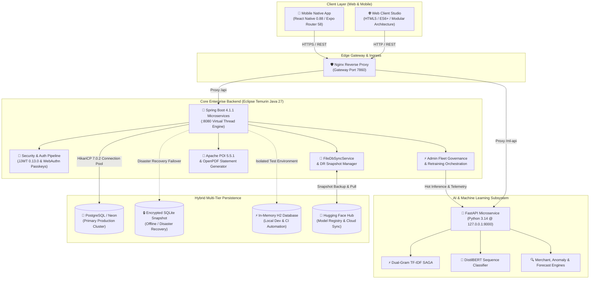
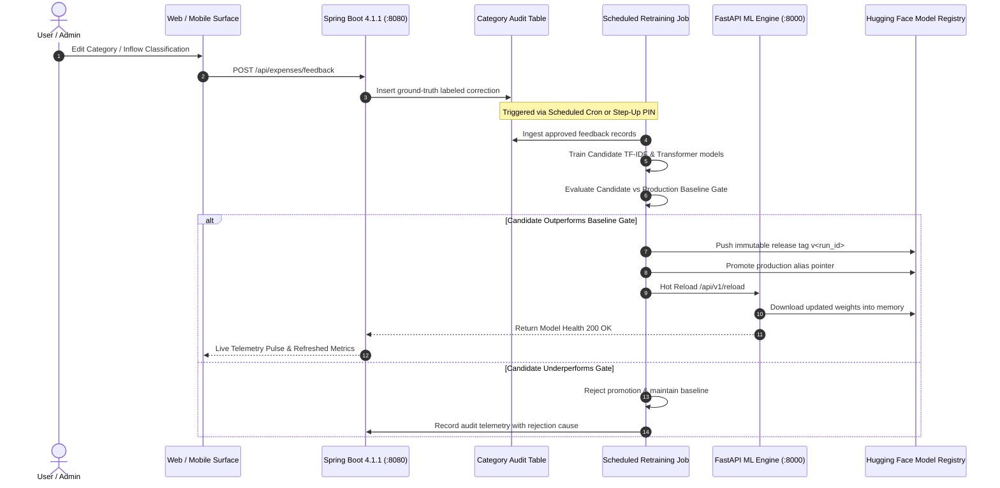
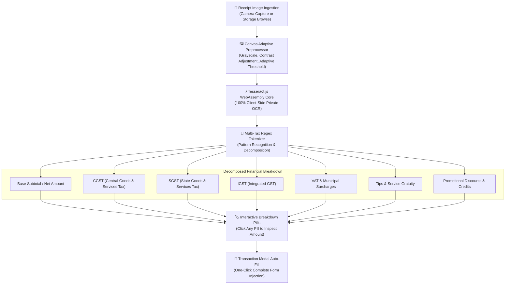

<div align="center">


<br/>

<a href="https://github.com/Yoge-2004/expense-tracker">
  
</a>

<br/>

<p align="center">
  <a href="https://github.com/Yoge-2004/expense-tracker/actions/workflows/ci.yml">
    
  </a>
  <a href="https://github.com/Yoge-2004/expense-tracker/actions/workflows/android-apk.yml">
    
  </a>
  <a href="https://huggingface.co/spaces/Yoge-2004/expense-tracker-backend">
    
  </a>
  <a href="https://github.com/Yoge-2004/expense-tracker/releases/latest">
    
  </a>
  <a href="LICENSE">
    
  </a>
</p>

<p align="center">
  <b>Enterprise-Grade Personal Finance Workspace • Synchronized Cross-Platform Engine</b>
  <br/>
  <a href="#-table-of-contents">Table of Contents</a> •
  <a href="#-enterprise-architecture--system-topology">System Architecture</a> •
  <a href="#-comprehensive-feature-portfolio">Feature Portfolio</a> •
  <a href="#-machine-learning--continuous-intelligence-fleet">ML Fleet</a> •
  <a href="#-technology-stack-architecture">Tech Stack</a> •
  <a href="#-testing-ecosystem-557-tests">Testing Suite</a>
</p>


</div>

## 📑 Table of Contents

- [🌟 Executive Overview](#-executive-overview)
- [🏗️ Enterprise Architecture & System Topology](#️-enterprise-architecture--system-topology)
  - [1. High-Level Distributed Infrastructure (C4 Model)](#1-high-level-distributed-infrastructure-c4-model)
  - [2. Spring Boot Backend Layered Architecture](#2-spring-boot-backend-layered-architecture)
  - [3. Continuous ML Fleet Retraining & Feedback Loop](#3-continuous-ml-fleet-retraining--feedback-loop)
  - [4. Client-Side Dual-Mode OCR & Multi-Tax Decomposition Pipeline](#4-client-side-dual-mode-ocr--multi-tax-decomposition-pipeline)
- [💎 Comprehensive Feature Portfolio](#-comprehensive-feature-portfolio)
  - [1. Unified Cash Flow Ledger & Dual-Stream Audit Trail](#1-unified-cash-flow-ledger--dual-stream-audit-trail)
  - [2. Multi-Tax Receipt OCR Scanner](#2-multi-tax-receipt-ocr-scanner-client-side-privacy-first)
  - [3. Continuous Intelligence Machine Learning Fleet](#3-continuous-intelligence-machine-learning-fleet)
  - [4. Power BI-Grade Excel Analytics & Interactive Data Hub](#4-power-bi-grade-excel-analytics--interactive-data-hub)
  - [5. Web Studio & Universal Appearance Engine](#5-web-studio--universal-appearance-engine)
  - [6. Executive Command Palette & Fluid Ambient HUD Pointer](#6-executive-command-palette-ctrlcmd--k--fluid-ambient-hud-pointer)
  - [7. Draggable Quick Calculator & Multi-Currency FX Converter](#7-draggable-quick-calculator--multi-currency-fx-converter)
  - [8. Stealth Privacy Mode & Visual Obfuscation](#8-stealth-privacy-mode--visual-obfuscation)
  - [9. Safe-to-Spend Daily Allowance & No-Spend Habit Streaks](#9-safe-to-spend-daily-allowance--no-spend-habit-streaks)
  - [10. Active Subscriptions & Recurring Financial Commitment Engine](#10-active-subscriptions--recurring-financial-commitment-engine)
  - [11. Savings Goals Milestones & Contribution Vault](#11-savings-goals-milestones--contribution-vault)
  - [12. Zero-Trust Security, WebAuthn Passkeys & Step-Up Admin PIN](#12-zero-trust-security-webauthn-passkeys--step-up-admin-pin)
- [📱 Mobile Native Companion (React Native & Expo Router)](#-mobile-native-companion-react-native--expo-router)
- [🎮 Gestures & Keyboard Shortcuts Guide](#-gestures--keyboard-shortcuts-guide)
- [🛠️ Technology Stack Architecture](#️-technology-stack-architecture)
- [📂 Repository Layout](#-repository-layout)
- [🚀 Quick Start Guide](#-quick-start-guide)
- [⚙️ Environment Variables Reference](#️-environment-variables-reference)
- [🧪 Testing Ecosystem (557+ Tests)](#-testing-ecosystem-557-tests)
- [📦 Releases & Installation](#-releases--installation)


## 🌟 Executive Overview

**ExpenseTracker PRO** is an enterprise-grade financial command center designed around one immutable principle: **financial recording, intelligence, and reconciliation should be instantaneous, zero-latency, and architecturally resilient.**

Operating on **Java 27** using Generational ZGC, **Spring Boot 4.1.1**, **Python 3.14**, and **Expo React Native**, the platform combines three cooperating surfaces:
1. **🌐 Web Studio** — High-velocity browser command center with customizable appearance atmosphere, diffused golden aura elevation, and sub-millisecond filtering.
2. **📱 Mobile Native Suite** — Expo React Native client supporting offline caching, native haptic feedback, SMS bank debit parsing, and biometric authentication.
3. **⚙️ Enterprise Core API** — Spring Boot microservices managing JWT/OAuth2/WebAuthn identity, business rule validation, audit trails, and Apache POI Excel analytics.
4. **🧠 AI Machine Learning Microservice** — Dedicated Python 3.14 FastAPI engine powering dual-model categorization, merchant index vectorization, transaction anomaly scoring, and automated retraining pipelines.

<picture>
  <source media="(prefers-color-scheme: dark)" srcset="docs/images/website/hero-dashboard.png">
  <source media="(prefers-color-scheme: light)" srcset="docs/images/website/hero-dashboard.png">
  
</picture>


## 🏗️ Enterprise Architecture & System Topology

### 1. High-Level Distributed Infrastructure (C4 Model)



<picture>
  <source media="(prefers-color-scheme: dark)" srcset="docs/images/architecture/system-architecture.png">
  
</picture>

---

### 2. Spring Boot Backend Layered Architecture


---

### 3. Continuous ML Fleet Retraining & Feedback Loop



---

### 4. Client-Side Dual-Mode OCR & Multi-Tax Decomposition Pipeline




## 💎 Comprehensive Feature Portfolio

### 1. Unified Cash Flow Ledger & Dual-Stream Audit Trail

The **Unified Ledger** combines expense outflows and income inflows into a single, high-density chronological timeline:
- **Instant Multi-Column Search**: Filter by merchant, note, tags, category, or payment mode with debounced sub-millisecond DOM updates.
- **Bi-Directional Sorting**: Sort instantly by date, magnitude, category, or cadence (one-time vs recurring).
- **Inline Action System**: Rapid-edit and safety-confirmed delete workflows without losing scroll position.
- **Custom Category Tokens**: Tag expenses with custom luxury color badges and vector glyphs.

<picture>
  <source media="(prefers-color-scheme: dark)" srcset="docs/images/website/expenses.png">
  
</picture>

---

### 2. Multi-Tax Receipt OCR Scanner (Client-Side Privacy-First)

Powered by client-side WebAssembly, the scanner processes invoices locally on the user's device without transmitting receipt photos to external servers:
- **Dual Ingestion**: Real-time live camera capture or drag-and-drop file browse from gallery/desktop.
- **Adaptive Image Processing**: Canvas filters apply binarization, adaptive contrast, and edge sharpening to decipher faded thermal paper receipts.
- **Comprehensive Tax Parsing**: Automatically tokenizes and isolates:
  - Base Subtotal / Pre-Tax Net Amount
  - CGST (Central Goods & Services Tax) & SGST (State GST)
  - IGST (Integrated Interstate GST)
  - VAT (Value Added Tax) & Hospitality Service Charges
  - Gratuity / Courier Delivery Fees
  - Deductions and Promotional Discounts (e.g. `-10%`, `-₹150.00`)
- **Interactive Breakdown Matrix**: Renders visual tax pills below the scan viewport. Clicking any pill auto-fills the expense creation form in 1 click.

<picture>
  <source media="(prefers-color-scheme: dark)" srcset="docs/images/website/add-expense.png">
  
</picture>

---

### 3. Continuous Intelligence Machine Learning Fleet

The ML subsystem operates as an asynchronous, thread-safe microservice running alongside Spring Boot:
- **Dual-Engine Architecture**:
  - `TF-IDF + Logistic Regression (SAGA)`: Sub-millisecond inference for instant categorization of standard transactions.
  - `DistilBERT Sequence Classifier`: Fine-tuned contextual transformer for ambiguous or composite descriptions.
- **Auxiliary Intelligence Models**:
  - `Merchant Similarity Index`: Fuzzy vector similarity for merchant deduplication.
  - `Duplicate Transaction Detector`: Flags accidental double-swipes based on temporal and financial proximity.
  - `Transaction Anomaly Scorer`: Isolates outlier spending using unsupervised Isolation Forests.
  - `Spending Forecaster`: Generates 7-to-30 day predictive cash flow estimates based on historical spending cadence.
- **Automated Continuous Learning Loop**:
  - Collects user category reclassifications in a secure audit log.
  - Retraining pipeline triggers via Hugging Face scheduled jobs or manual Admin Step-Up PIN.
  - Strict evaluation gates reject candidate models unless they outperform the production baseline.

<picture>
  <source media="(prefers-color-scheme: dark)" srcset="docs/images/website/dashboard.png">
  
</picture>

---

### 4. Power BI-Grade Excel Analytics & Interactive Data Hub

- **Executive Excel Workbooks**: Generates formatted `.xlsx` workbooks styled to modern Power BI dashboards using Apache POI:
  - KPI Executive Cards (Total Spend, Inflow Velocity, Net Reserves, Savings Rate)
  - Category breakdown distribution matrices with formatted percentages
  - Formatted chronological ledgers with currency symbols and status indicators
- **High-Throughput Data Hub**: Bidirectional CSV and Excel import/export engine supporting up to 50MB and 500,000+ records with streaming memory safety.
- **OpenPDF Statement Export**: Download formatted PDF account statements for tax preparation and auditing.

<picture>
  <source media="(prefers-color-scheme: dark)" srcset="docs/images/website/report-exports.png">
  
</picture>

---

### 5. Web Studio & Universal Appearance Engine

- **Wallpaper Atmosphere**: Upload custom wallpaper imagery or choose from curated luxury presets with real-time blur (0–20px) and opacity (0.0–0.9) sliders.
- **Dynamic Palette Token Generator**: Automatically extracts vibrant dominant colors or allows fine-tuned customization of `--primary`, `--accent`, and `--highlight` tokens.
- **Dynamic Font Engine**: Select from curated typefaces (**Hanken Grotesk**, **Fraunces**, **IBM Plex Mono**, or System Sans) or dynamically upload custom `.woff2`/`.ttf` fonts via the FontFace API.
- **Atomic Theme Switch Guard**: Suppresses multi-node transition bursts during theme swaps, ensuring 60fps frame rates across huge financial ledgers.

---

### 6. Executive Command Palette (<kbd>Ctrl</kbd>/<kbd>Cmd</kbd> + <kbd>K</kbd>) & Fluid Ambient HUD Pointer

- **Keyboard-First Command Hub**: Press <kbd>Ctrl + K</kbd> (Windows/Linux) or <kbd>Cmd + K</kbd> (macOS) anywhere on the web dashboard to open an instant modal command center.
- **Fluid Ambient HUD Cursor**: Custom ambient dot-ring pointer provides smooth hover elevation and proximity feedback on interactive elements.
- **Integrated Onboarding & Help Guide**: Contextual in-app documentation modal guiding new operators through keyboard accelerators and system topology.

---

### 7. Draggable Quick Calculator & Multi-Currency FX Converter

- **Floating Accessibility**: Press <kbd>Alt + C</kbd> or tap the floating gold bubble to launch a dockable, draggable on-screen calculator.
- **1-Tap Bill Splitting**: Quick division chips (`1x`, `÷2`, `÷3`, `÷4`, `÷5`) for dining and shared group expenses.
- **Instant Modal Injection**: Click **Use Amount** to prefill the calculated figure directly into the active expense or income form.
- **Daily Multi-Currency FX Engine**: Real-time exchange rate conversions (USD, EUR, GBP, AED ➔ INR) via `open.er-api.com` with 24-hour device caching.

---

### 8. Stealth Privacy Mode & Visual Obfuscation

- **Instant Privacy Shield**: Press <kbd>Alt + S</kbd> or click the top bar eye icon (`👁️`) in public spaces, airports, or cafes.
- **Full Value Masking**: Instantly blurs and masks all balances, inflows, outflows, and transaction values with bullets (`••••••`) to protect against shoulder-surfing.

---

### 9. Safe-to-Spend Daily Allowance & No-Spend Habit Streaks

- **Safe-to-Spend Metric**: Dynamic real-time calculation representing your safe daily discretionary allowance:
  $$	ext{Safe-to-Spend} = rac{	ext{Monthly Budget Remaining} - 	ext{Scheduled Subscriptions Remaining}}{	ext{Days Remaining in Month}}$$
- **No-Spend Day Streak Tracker**: Habit-building streak counter celebrating consecutive zero-discretionary outflow days with animated fire milestone badges.

<picture>
  <source media="(prefers-color-scheme: dark)" srcset="docs/images/website/budget-progress.png">
  
</picture>

---

### 10. Active Subscriptions & Recurring Financial Commitment Engine

- Tracks monthly, quarterly, and annual subscriptions with renewal countdown indicators.
- Automatically projects upcoming commitment deductions to protect against overdrafts.

<picture>
  <source media="(prefers-color-scheme: dark)" srcset="docs/images/website/recurring.png">
  
</picture>

---

### 11. Savings Goals Milestones & Contribution Vault

- Set milestone targets, monitor calculated completion percentages, and execute incremental deposit contributions.

<picture>
  <source media="(prefers-color-scheme: dark)" srcset="docs/images/website/savings-goals.png">
  
</picture>

---

### 12. Zero-Trust Security, WebAuthn Passkeys & Step-Up Admin PIN

- **Stateless JJWT 0.13.0 Tokens**: High-entropy HMAC-SHA256 authenticated sessions.
- **WebAuthn / FIDO2 Passkeys**: Cryptographic hardware-backed biometric sign-in (Touch ID, Face ID, Windows Hello).
- **6-Digit Security PIN Vault**: Instant account recovery without third-party email dependencies.
- **Step-Up Admin Authorization**: Administrative operations (such as ML model retraining triggers and privilege adjustments) require 6-digit non-repudiation PIN verification.

<picture>
  <source media="(prefers-color-scheme: dark)" srcset="docs/images/website/auth-login.png">
  
</picture>


## 📱 Mobile Native Companion (React Native & Expo Router)

The mobile companion application in `mobile/` is built on **React Native 0.88, React 19.3, and Expo Router 58**:
- **Native Gesture Navigation**: Swipe right on ledger rows to edit, swipe left to delete with custom haptic feedback.
- **SMS Debit Listener**: Automatically captures incoming banking SMS notifications (UPI, NEFT, IMPS, Cards) and extracts transaction details.
- **Biometric Unlock**: Integrated `expo-local-authentication` for fingerprint and Face ID authentication.
- **Adaptive Screen Orientations**: Seamless portrait and landscape layout transitions across smartphones, foldables, and tablets.

<picture>
  <source media="(prefers-color-scheme: dark)" srcset="docs/images/mobile/app-collage.png">
  
</picture>


## 🎮 Gestures & Keyboard Shortcuts Guide

### 📱 Mobile Native Touch Gestures

| Gesture | Target Surface | Action Triggered | Haptic Profile |
|---|---|---|---|
| **Swipe Right** (`dx > +70px`) | Ledger Row | **Quick Edit**: Opens edit form with transaction pre-populated | `Light` impact |
| **Swipe Left** (`dx < -70px`) | Ledger Row | **Quick Delete**: Prompts delete confirmation modal | `Warning` notification |
| **Single Tap** | Ledger Row | **4-Way Action Sheet**: Split / Link Loan / Edit / Delete | `Light` impact |
| **Horizontal Pan** | Stream Tabs | **Cycle Stream**: All Activity ↔ Outflows ↔ Inflows | Smooth glide |
| **Press & Drag** | Floating Calculator | **Reposition Bubble**: Move calculator anywhere on screen | Continuous pan |
| **Header Eye Tap** (`👁️`) | Top Bar | **Stealth Privacy Mode**: Masks numbers with `••••••` | `Light` impact |
| **Pull Down** | Any Screen View | **Pull-to-Refresh**: Bypasses local cache and synchronizes | System trigger |

### 🌐 Web & Desktop Keyboard Shortcuts

| Shortcut | Context / Scope | Functionality |
|---|---|---|
| <kbd>Ctrl</kbd> / <kbd>Cmd</kbd> + <kbd>K</kbd> | Global | **Executive Command Palette**: Jump between tabs, trigger modals, search |
| <kbd>Alt</kbd> + <kbd>C</kbd> | Global | **Floating Calculator**: Toggle quick calculator & bill splitter |
| <kbd>Alt</kbd> + <kbd>S</kbd> | Global | **Stealth Privacy Mode**: Instantly mask all financial numbers |
| <kbd>Alt</kbd> + <kbd>T</kbd> | Global | **Web Studio**: Open Appearance, Palette, and Wallpaper editor |
| <kbd>/</kbd> (Forward Slash) | Dashboard | **Quick Search**: Focus transaction & inflow filter input |
| <kbd>Escape</kbd> | Global | **Dismiss**: Close active modals, menus, and command palette |


## 🛠️ Technology Stack Architecture

<div align="center">

| Tier | Component / Library | Version | Purpose & Architectural Responsibility |
|---|---|---|---|
| **Language & Runtime** | Eclipse Temurin JDK | `Java 27` | Generational ZGC, Virtual Threads, high-throughput bytecode execution |
| **Core Framework** | Spring Boot | `4.1.1` | REST APIs, IoC container, auto-configuration, production actuator metrics |
| **Security & Auth** | Spring Security / JJWT | `0.13.0` | Stateless token authentication, Google OAuth 2.0, WebAuthn Passkeys |
| **Persistence Engine** | Hibernate / Spring Data | `7.4.5` | JPA Entity relational mapping, HikariCP 7.0.2 connection pooling |
| **Relational Database** | PostgreSQL / Neon | `42.7.13` | Primary cloud database with client-encrypted SQLite disaster fallback |
| **Reporting & Export** | Apache POI / OpenPDF | `5.5.1` / `3.0.5` | Power BI-grade Excel dashboards, PDF statements, 50MB multipart limit |
| **Client OCR Engine** | Tesseract.js | WebAssembly | Client-side privacy-first optical character recognition & multi-tax parser |
| **API Contract** | SpringDoc OpenAPI | `3.1.0` | Swagger UI 5.32, OpenAPI 3.1.0 interactive documentation |
| **Web Frontend** | Modular HTML5 / ES6+ | Modern | Theme Performance Engine, Web Studio, custom HUD cursor, Chart.js |
| **Mobile Core** | React Native / Expo | `0.88` / `58` | Cross-platform native mobile app, Expo Router 58, React 19.3 |
| **Mobile Gestures** | React Native Worklets | `0.13.0` | Native 60fps gesture transitions, memoized context re-render guards |
| **Machine Learning** | Python / FastAPI / Scikit | `3.14` / `0.3.0` | Dual-engine ML categorization, merchant similarity, anomaly detection |
| **Package Manager** | Astral UV | `0.11.21` | Deterministic ultra-fast Python environment resolution & syncing |
| **Testing Harness** | JUnit 6, Playwright, Jest | Latest | 136 Unit tests, 19 Cucumber BDD, 191 Playwright E2E, 60+ Jest tests |
| **Container Engine** | Multi-Stage Docker | Linux OCI | Eclipse Temurin 27-JRE + Python 3.14 unified Hugging Face Space |

</div>


## 📂 Repository Layout

```text
expense-tracker/
├── frontend/                    # Web client application
│   ├── css/                     # UI stylesheets (admin, web-studio, responsive)
│   ├── js/                      # Browser logic & modules (web-studio, custom-controls)
│   ├── index.html               # Authentication portal
│   ├── dashboard.html           # Personal financial command center
│   └── admin.html               # Platform administration & ML fleet governance
│
├── mobile/                      # Expo React Native mobile application
│   ├── app/                     # Expo Router file-based route screens
│   ├── components/              # Native UI components (Ledger, ThemedScrollbar, Calculator)
│   ├── constants/               # Theme tokens, font configurations, API contracts
│   ├── context/                 # State providers (PreferencesContext, AuthContext)
│   ├── services/                # API gateway, SMS debit parser, receipt OCR
│   └── __tests__/               # Jest test suites (160 tests passed)
│
├── ml/                          # Machine Learning microservice
│   ├── api/                     # FastAPI inference microservice (:8000)
│   ├── jobs/                    # Automated Hugging Face retraining scripts
│   ├── src/expense_ml/          # Inference service, model registry, preprocessing
│   ├── tests/                   # Pytest test suite (55 tests passed)
│   └── pyproject.toml           # Python package specifications (UV managed)
│
├── src/main/java/               # Spring Boot production backend (Java 27)
│   └── com/example/expensetracker/
│       ├── config/              # Security, CORS, Swagger, Dynamic DataSource Router
│       ├── controller/          # REST endpoints (Expenses, Incomes, Budgets, Admin)
│       ├── dto/                 # Request/response validation schemas
│       ├── model/               # JPA database entities
│       ├── repository/          # Spring Data JPA repositories
│       └── service/             # Business rules, ML governance, POI Excel reporting
│
├── docker/                      # Production container orchestrator
│   ├── entrypoint.sh            # Container bootstrap & file permissions guarantee
│   ├── nginx.conf               # Reverse proxy (7860 -> 8080 & 8000)
│   └── supervisord.conf         # Multi-daemon process supervisor
│
├── e2e/                         # Playwright TypeScript browser automation suite
├── Dockerfile                   # Multi-stage production container
├── pom.xml                      # Maven project configuration (Java 27)
└── run-tests.sh                 # Unified cross-platform test runner
```


## 🚀 Quick Start Guide

### Prerequisites
- **Java 27 JDK** (Eclipse Temurin recommended)
- **Maven 3.9+** (or use included `./mvnw`)
- **Node.js 18+** & npm (for Web E2E and Mobile app)
- **Python 3.14** with **uv** (if developing ML models locally)

### 1. Launch Backend API (Spring Boot)

```bash
git clone https://github.com/Yoge-2004/expense-tracker.git
cd expense-tracker

# Start the Spring Boot backend on http://localhost:8080
./mvnw spring-boot:run
```

### 2. Launch Web Client

Serve the `frontend/` directory using any local static web server:

```bash
cd frontend
python3 -m http.server 5500
# Open http://localhost:5500 in your browser
```

### 3. Launch Mobile Companion App (Expo React Native)

```bash
cd mobile
npm install

# Start the Expo interactive development server
npx expo start
```

*Press `a` for Android Emulator, `i` for iOS Simulator, or scan the QR code with Expo Go.*

### 4. Run via Docker (Combined Production Space)

```bash
# Package production Spring Boot artifact
./mvnw clean package -DskipTests

# Build unified multi-process container
docker build -t expense-tracker-prod .

# Run container exposing gateway port 7860
docker run --rm -p 7860:7860   -e SPRING_DATASOURCE_URL="jdbc:h2:mem:expensetrackerdb"   -e JWT_SECRET="your-256-bit-hex-secret-key-here"   expense-tracker-prod
```


## ⚙️ Environment Variables Reference

| Variable | Scope | Purpose | Default / Example |
|---|---|---|---|
| `SPRING_DATASOURCE_URL` | Backend | JDBC connection string | `jdbc:postgresql://ep-xyz.neon.tech/neondb` |
| `SPRING_DATASOURCE_USERNAME` | Backend | Database access username | `neondb_owner` |
| `SPRING_DATASOURCE_PASSWORD` | Backend | Database access password | `••••••••••••` |
| `JWT_SECRET` | Backend | HMAC-SHA256 signing secret for JWT tokens | Hex or Base64 string |
| `GOOGLE_OAUTH_CLIENT_ID` | Backend | Google OAuth Web Client ID for token audience checks | `xyz.apps.googleusercontent.com` |
| `CORS_ALLOWED_ORIGINS` | Backend | Comma-separated allowed web origins | `http://localhost:5500,https://app.netlify.app` |
| `HF_TOKEN` | Sync / ML | Hugging Face user write access token | `hf_••••••••••••` |
| `DB_BACKUP_KEY` | Disaster Recovery | AES encryption key for client SQLite snapshots | 256-bit passphrase |
| `MODEL_ID` | ML Fleet | Hugging Face model repository ID | `Yoge-2004/expense-intelligence-model` |
| `MODEL_TYPE` | ML Fleet | Inference engine choice (`tfidf` or `transformer`) | `tfidf` |


## 🧪 Testing Ecosystem (557+ Tests)

ExpenseTracker PRO enforces end-to-end quality assurance across unit, integration, BDD, and browser layers.

<div align="center">

| Suite | Tooling | Tests | Command | Coverage Area |
|---|---|---|---|---|
| **Backend Unit & Controller** | JUnit 6 + Mockito | `136` | `./mvnw test` | Service business logic, HTTP contracts, security filters |
| **Backend BDD Scenarios** | Cucumber BDD | `19` | `./mvnw test -Dtest=CucumberTestRunner` | User journeys (Auth, Expenses, Export) |
| **Web Browser E2E (TypeScript)** | Playwright Test | `162` | `cd e2e && npm test` | Cross-browser flows (login, dashboard, modals) |
| **Web Browser E2E (Java)** | Playwright Java | `29` | `./mvnw test -Dplaywright=true` | Full-stack server + browser integration |
| **Mobile App Unit Tests** | Jest + React Native | `160` | `cd mobile && npm test` | Currency math, OCR, context hooks, themes |
| **Python ML Fleet Tests** | Pytest + Ruff | `55` | `cd ml && uv run pytest` | Model registry, API endpoints, retraining gate |

</div>

### Unified Cross-Platform Runner

```bash
# Run all core test suites with one command
./run-tests.sh

# Install all dependencies and run complete fleet
./run-tests.sh --install-deps --all
```


## 📦 Releases & Installation

- **Latest Android APK**: [**Download v1.0.9 (Build 11)**](https://github.com/Yoge-2004/expense-tracker/releases/latest)
- **Detailed Release Notes**: Read [RELEASE_NOTES.md](RELEASE_NOTES.md) for full change logs, security enhancements, and migration notes.

---

<div align="center">
  <sub>Engineered with precision by <a href="https://github.com/Yoge-2004">Yoge-2004</a> • Released under the MIT License</sub>
</div>
