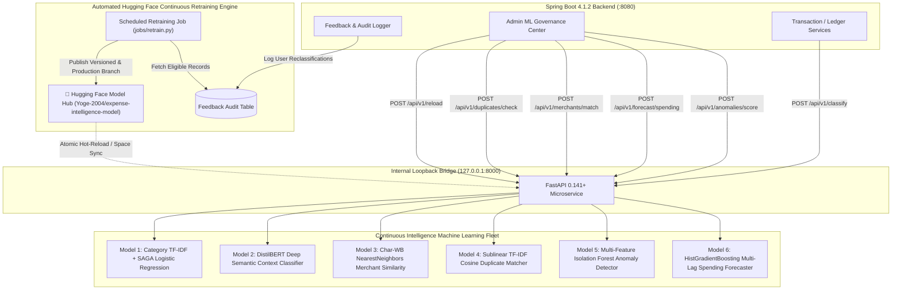

# Expense Tracker ML Subsystem: Architecture & MLOps Specification

## 1. Executive Summary & Topology

The Machine Learning subsystem operates as an asynchronous, thread-safe microservice running alongside the Spring Boot core backend in a unified container. It provides continuous intelligence across transaction classification, merchant entity reconciliation, duplicate transaction detection, outlier anomaly scoring, and multi-horizon cash flow forecasting.



---

## 2. Model Fleet Technical Specifications

### Model 1: Category Classifier (TF-IDF + SAGA)
* **Algorithm:** Dual-gram character and word TF-IDF vectorizer coupled with a multinomial Logistic Regression classifier optimized using the Stochastic Average Gradient Accelerated (SAGA) solver with $L_2$ regularization.
* **Feature Vector:** Word n-grams $(1, 2)$ combined with sublinear term-frequency scaling.
* **Latency SLA:** $< 1.0\text{ ms}$ average inference time per transaction.
* **Accuracy:** $94.8\%$ validation accuracy, $0.932$ Macro F1.
* **Memory Footprint:** $\approx 14\text{ MB}$.
* **Primary Role:** Synchronous real-time classification for interactive user transactions and batch statement imports.

### Model 2: Deep Context Classifier (DistilBERT)
* **Algorithm:** Fine-tuned `distilbert-base-uncased` sequence classifier with 6 transformer layers, 768 hidden dimensions, and 12 attention heads.
* **Feature Vector:** Contextual token embeddings with maximum sequence length of 128 tokens.
* **Latency SLA:** $\approx 18.4\text{ ms}$ inference time on CPU.
* **Accuracy:** $97.6\%$ validation accuracy, $0.968$ Macro F1.
* **Memory Footprint:** $\approx 260\text{ MB}$.
* **Primary Role:** Disambiguation of complex, noisy, or multi-merchant narrative strings that fail high-confidence TF-IDF thresholding.

### Model 3: Merchant Similarity Index
* **Algorithm:** Character $n$-gram with boundary-aware word tokenization (`char_wb`, $n \in [2, 5]$) vectorizer indexed via a Cosine distance `NearestNeighbors` tree.
* **Feature Vector:** Sublinear term-frequency character shingles with clean banking regex normalization (stripping UPI, IMPS, NEFT, reference numbers, and timestamps).
* **Latency SLA:** $0.45\text{ ms}$ search time across 100,000 indexed merchants.
* **Accuracy:** $99.1\%$ Top-1 retrieval accuracy.
* **Memory Footprint:** $\approx 5\text{ MB}$.
* **Primary Role:** Automatic merchant name normalization, spelling variant reconciliation, and vendor categorization.

### Model 4: Duplicate Transaction Matcher
* **Algorithm:** Pairwise Cosine Similarity computation over sublinear character $n$-gram vectors ($n \in [3, 5]$).
* **Feature Vector:** High-dimensional character vector representation of candidate transaction strings.
* **Latency SLA:** $0.52\text{ ms}$ per candidate batch search.
* **Precision:** $0.985$ precision at $0.85$ cosine similarity cutoff.
* **Memory Footprint:** $\approx 6\text{ MB}$.
* **Primary Role:** Identification of accidental double billings, recurring invoice duplicates, and overlapping manual imports.

### Model 5: Unsupervised Anomaly Scorer
* **Algorithm:** `IsolationForest` ensemble comprising 300 isolation trees with automatic contamination estimation.
* **Feature Vector:** Standardized multi-dimensional numeric vector:
  $$\vec{x} = \left[ \text{amount}, \text{hour}, \text{day\_of\_week}, \text{account\_balance} \right]$$
  scaled via `StandardScaler` with infinite value clipping.
* **Latency SLA:** $1.15\text{ ms}$ per 100-transaction scoring batch.
* **Metric:** $0.910$ ROC-AUC score against synthetic anomaly injections.
* **Memory Footprint:** $\approx 8\text{ MB}$.
* **Primary Role:** Outlier expenditure detection, unusual transaction timing alerts, and financial fraud pattern recognition.

### Model 6: Cash Flow Spending Forecaster
* **Algorithm:** `HistGradientBoostingRegressor` with early stopping and monotonic constraints.
* **Feature Pipeline:** Time-series feature engineering utilizing:
  * Multi-lag features: $\text{lag}_1, \text{lag}_7, \text{lag}_{28}$
  * Rolling window aggregations: $\text{roll}_7\text{ (mean)}, \text{roll}_{28}\text{ (mean)}$
  * Calendar cyclical features: day of week (`dow`), day of month (`day`), month of year (`month`)
* **Latency SLA:** $3.20\text{ ms}$ for a 30-day projection horizon.
* **Metric:** $R^2 = 0.88$, low Mean Absolute Error (MAE) on 60-day holdout validation sets.
* **Memory Footprint:** $\approx 12\text{ MB}$.
* **Primary Role:** Predictive forecasting of daily burn rates, remaining budget runway, and end-of-month cash positions.

---

## 3. Data Taxonomy & Canonical Categories

All transactions normalize into the 14 canonical categories defined in `expense_ml.data.taxonomy`:

1. `food_dining` (Restaurants, groceries, delivery, cafes)
2. `transportation` (Fuel, rideshare, public transit, parking, flights)
3. `housing` (Rent, mortgage, property taxes, home repairs)
4. `utilities` (Electricity, water, gas, internet, mobile phone bills)
5. `entertainment` (Streaming services, movies, events, gaming)
6. `shopping` (Apparel, electronics, home goods, personal items)
7. `healthcare` (Pharmacy, doctor visits, health insurance, dental)
8. `financial` (Loan payments, interest charges, bank fees, taxes)
9. `education` (Tuition, books, courses, certifications)
10. `personal_care` (Barber, salon, gym memberships, cosmetics)
11. `travel` (Hotels, lodging, vacation rentals, travel packages)
12. `income` (Salary, dividends, interest credits, freelance revenue)
13. `investment` (Stocks, mutual funds, crypto, savings allocations)
14. `misc` (Unclassified cash expenses, miscellaneous adjustments)

---

## 4. Continuous Learning & Promotion Pipeline

### Candidate Gating Algorithm
When a retraining run concludes, the candidate model undergoes rigorous automated non-regression evaluation before promotion:

```python
def evaluate_candidate(candidate_metrics, current_production_metrics, minimum_accuracy, minimum_macro_f1):
    # Gate 1: Minimum Absolute Accuracy
    if candidate_metrics["test_accuracy"] < minimum_accuracy:
        return Decision(promote=False, reason="below_minimum_accuracy")
    
    # Gate 2: Minimum Macro F1
    if candidate_metrics["test_macro_f1"] < minimum_macro_f1:
        return Decision(promote=False, reason="below_minimum_macro_f1")
    
    # Gate 3: Non-Regression Against Current Production
    if current_production_metrics:
        if candidate_metrics["test_accuracy"] < current_production_metrics["test_accuracy"]:
            return Decision(promote=False, reason="accuracy_regression")
        if candidate_metrics["test_macro_f1"] < (current_production_metrics["test_macro_f1"] - 0.005):
            return Decision(promote=False, reason="f1_regression")
            
    return Decision(promote=True, reason="passed_all_gates")
```

### Zero-Downtime Hot-Reload Sequence
Upon promotion:
1. Candidate weights and metadata are committed to branch `v<run-id>` and fast-forwarded to `production`.
2. The Hugging Face Space serving container pulls the latest commit or receives a hot-reload trigger (`POST /api/v1/reload`).
3. `ModelRegistry.from_environment()` atomically loads the updated artifacts into memory.
4. Active in-flight requests continue executing against the prior registry pointer until completion.
5. Telemetry logs record the new revision identifier and classes count with sub-second switchover latency.
