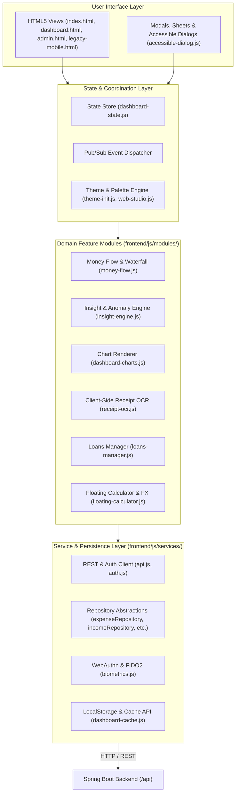

# Frontend Architecture & Engineering Specification

This document provides a comprehensive overview of the frontend client architecture, design principles, module hierarchy, state management, and accessibility standards for the Expense Tracker web application.

---

## 1. Architectural Overview & Design Patterns

The frontend application is built as an accessible, high-performance, responsive Single-Page Application (SPA) using modern ECMAScript standards (ES2022+), CSS variables, and HTML5 Web APIs. It runs without heavy framework overhead to achieve instantaneous page loads, predictable lifecycle execution, and universal cross-device compatibility (from 240px feature phones up to 4K desktop workstations).



### Key Engineering Patterns:
1. **Repository Pattern (`frontend/js/services/repositories/`):**
   - Decouples domain modules from raw HTTP requests. Repositories (`expenseRepository`, `incomeRepository`, `budgetRepository`, `categoryRepository`, `savingsGoalRepository`, `loansRepository`) encapsulate data access, validation, and serialization.
2. **Open/Closed Principle (OCP) for Components:**
   - Dialogs and modals are registered through [`accessible-dialog.js`](file:///home/yoge/IdeaProjects/expense-tracker-system/frontend/js/modules/accessible-dialog.js) without modifying global DOM listeners.
   - Chart renderers accept data providers polymorphically without hardcoded switch-case branching.
3. **Unidirectional Reactive State Flow:**
   - Centralized state in [`dashboard-state.js`](file:///home/yoge/IdeaProjects/expense-tracker-system/frontend/js/modules/dashboard-state.js) prevents race conditions and UI synchronization drift across widgets.
4. **Resilient Offline Caching:**
   - Transaction summaries, currency preferences, and theme tokens are cached in `localStorage` and synchronized with the backend on reconnection.

---

## 2. Directory Layout & Module Responsibilities

```
frontend/
├── index.html                   # Authentication entry point (Login, Register, WebAuthn Passkeys)
├── dashboard.html               # Main financial command dashboard
├── admin.html                   # System administrator management console
├── legacy-mobile.html           # Dedicated retro layout for early mobile browsers (Android 1.0, iOS 1.0)
├── sw.js                        # Progressive Web App (PWA) Service Worker & offline asset cache
├── css/
│   ├── style.css                # Primary stylesheet & design system core
│   ├── design-system.css        # CSS variables, typography tokens, semantic color mappings
│   ├── responsive.css           # Responsive layout queries (breakpoints: 1400px, 1024px, 768px, 480px, 320px)
│   ├── feature-phone.css        # Zero-overflow layout & D-Pad navigation for KaiOS / button devices (<= 360px)
│   ├── motion-extended.css      # Fluid CSS animations with prefers-reduced-motion support
│   └── ai-intelligence.css      # Styles for ML insight cards, anomaly badges, and forecast bars
└── js/
    ├── api.js                   # Authenticated HTTP client with token refresh & interceptors
    ├── auth.js                  # JWT token management, session lifecycle, and logout handlers
    ├── biometrics.js            # WebAuthn FIDO2 passkey registration and authentication
    ├── dashboard.js             # Orchestrator coordinating all dashboard feature modules
    ├── feature-phone.js         # Physical D-pad key listeners (SoftKeys, arrow keys, numeric shortcuts)
    ├── motion.js                # Micro-interactions, parallax, and smooth transitions
    ├── perf-guard.js            # Performance monitoring (FCP, LCP, CLS) and canvas resource guard
    ├── register.js              # User registration with live username suggestion engine
    ├── theme-init.js            # Early theme application script preventing Flash of Unstyled Content (FOUC)
    ├── modules/
    │   ├── accessible-dialog.js # WAI-ARIA compliant modal dialogs with focus trapping
    │   ├── command-palette.js   # Quick navigation palette (Cmd/Ctrl + K)
    │   ├── currency-service.js  # Currency formatting, locale detection, and symbol mapping
    │   ├── dashboard-charts.js  # Interactive SVG and Canvas chart rendering (Trend, Donut, Bar)
    │   ├── dashboard-data.js    # Data loading, pagination, and multi-stream collation
    │   ├── dashboard-ml.js      # Client-side interface to FastAPI categorization and anomaly scores
    │   ├── dashboard-state.js   # Reactive state container for active ledger entries and filters
    │   ├── floating-calculator.js # Draggable arithmetic calculator and currency converter
    │   ├── insight-engine.js    # Client-side rule evaluation, savings streaks, and burn rate
    │   ├── loans-manager.js     # Debt and credit tracking, settlement toggles, and loan metrics
    │   ├── money-flow.js        # Net cash flow waterfall calculations and visual breakdown
    │   ├── receipt-ocr.js       # Client-side Tesseract WebAssembly OCR and multi-tax parser
    │   ├── ui-feedback.js       # Non-blocking toast notifications and confirmation alerts
    │   └── web-studio.js        # Dynamic theme customizer, contrast adjuster, and wallpaper engine
    └── services/
        └── repositories/        # Repository abstractions for backend entity management
```

---

## 3. UI Design Principles & Human Interface Guidelines

The user interface adheres to foundational HCI design laws:

1. **Fitts's Law:**
   - Primary action buttons (Record Expense, Record Income) are anchored with generous tap targets (minimum 44&times;44 CSS pixels on touch devices) and placed within natural reach zones.
2. **Hick's Law:**
   - Multi-step forms and categorizations group complex financial options into progressive disclosure accordions and search-first dropdowns, minimizing cognitive decision time.
3. **Miller's Rule (7 ± 2):**
   - High-level dashboards present metrics in modular cards grouped into 4 primary columns (Total Income, Total Expense, Net Balance, Active Budget Utilization), keeping working memory load low.
4. **Jakob's Law:**
   - Leverages standard financial conventions: Green for Inflow/Credits, Red/Amber for Outflow/Debits, Blue for Net/Neutral transfers, and standard ISO currency symbols.
5. **Zero Horizontal Overflow:**
   - Strict CSS rules guarantee that every page fits 100% within the viewport width down to 240px wide devices with zero horizontal scroll bleed.

---

## 4. Accessibility (WCAG 2.1 AA Compliance)

- **Keyboard Navigation:**
  - Full tab order navigation across all interactive elements with high-contrast `:focus-visible` rings (`outline: 2px solid #F59E0B`).
  - Feature-phone and retro mobile support via physical D-pad arrow keys and softkeys (`F1` for Left Softkey, `F2` for Right Softkey, `Enter` for Center OK).
- **Dialog Focus Management:**
  - When a modal opens via [`accessible-dialog.js`](file:///home/yoge/IdeaProjects/expense-tracker-system/frontend/js/modules/accessible-dialog.js), focus is automatically trapped within the modal, the `aria-modal="true"` attribute is applied, and pressing `Escape` closes the dialog and returns focus to the trigger button.
- **Screen Reader Support:**
  - Semantic HTML5 landmark elements (`<main>`, `<nav>`, `<header>`, `<section>`, `<aside>`).
  - Form inputs have explicit `<label>` tags with matching `for` attributes and descriptive `aria-label` tags for icon-only action buttons.
- **Color Contrast:**
  - Text contrast ratios exceed 4.5:1 for normal body text and 3:1 for large headings across all active color themes.

---

## 5. WebAuthn Passkeys & Security Architecture

The authentication layer in [`biometrics.js`](file:///home/yoge/IdeaProjects/expense-tracker-system/frontend/js/biometrics.js) integrates modern FIDO2 / WebAuthn browser APIs:
- **Registration:** Requests credential creation options from `POST /api/webauthn/register/options`, creates a public/private key pair on the user's hardware authenticator (TouchID, FaceID, Windows Hello, YubiKey), and submits the attested public key to `POST /api/webauthn/register/verify`.
- **Authentication:** Requests authentication challenges from `POST /api/webauthn/login/options`, signs the challenge with the device hardware key, and verifies the assertion via `POST /api/webauthn/login/verify`.
- **JWT Storage:** Session JWTs are managed with strict validation and expiration checks; sensitive credentials are never written to unencrypted logs.

---

## 6. Testing & Quality Verification

All frontend code undergoes rigorous automated testing in CI:
- **Syntax Verification:**
  - `find frontend/js -type f -name '*.js' -print0 | xargs -0 -n1 node --check`
- **Playwright Browser Tests (`e2e/`):**
  - Desktop Chrome: `npx playwright test --project=chromium`
  - Mobile Chrome (Pixel 7): `npx playwright test --project=mobile-chrome`
  - Retro Browsers: `tests/legacy-mobile.spec.ts` (320&times;480)
  - Feature Phones: `tests/feature-phone.spec.ts` (240&times;320)
